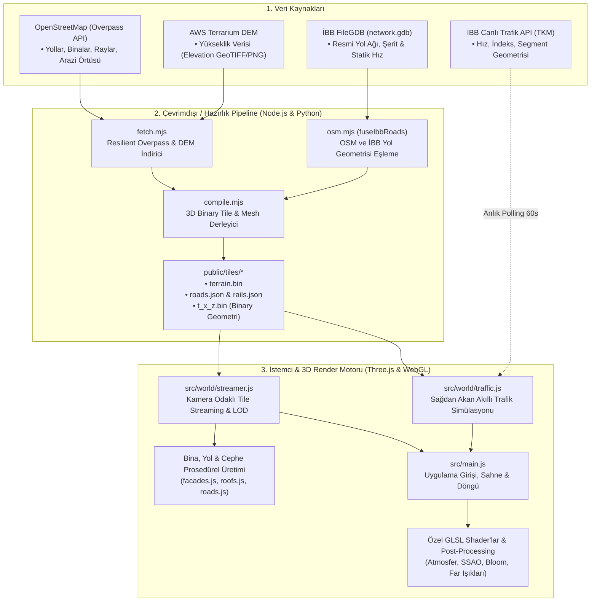

# Procedural Istanbul: Metodoloji ve Sistem Mimarisi

Bu doküman, **Procedural Istanbul** projesinin veri toplama (pipeline), işleme (compilation), 3D procedural render ve gerçek zamanlı trafik simülasyonu mimarisini detaylandırmaktadır.

---

## 1. Genel Mimari Bakış

Procedural Istanbul; açık coğrafi verileri (OpenStreetMap, Sayısal Yükseklik Modeli) ve İBB (İstanbul Büyükşehir Belediyesi) verilerini bir araya getirerek, tarayıcı üzerinde WebGL/Three.js ile sıfır harici oyun motoru (Unity/Unreal vb.) bağımlılığı olmadan gerçek zamanlı, prosedürel bir 3D şehir ve trafik simülasyonu üretir.



---

## 2. Veri Hazırlama ve Derleme Hattı (Pipeline)

### 2.1. Veri Toplama (`tools/pipeline/fetch.mjs`)
* **OSM Sorguları:** Overpass API üzerinden yollar (`highway=*`), binalar (`building=*`), raylar (`railway=*`) ve arazi örtüsü (`natural`, `leisure`, `landuse`) GeoJSON/OSM-JSON formatında çekilir.
* **Dayanıklılık (Resilience):** Overpass sunucularındaki rate-limit (HTTP 429/504) durumunda otomatik bekleme ve tekrar deneme (exponential backoff) uygulanır; kritik olmayan veri katmanları için boş geri dönüş (fallback) sağlanır.
* **Yükseklik Verisi (DEM):** İstanbul koordinatları için AWS Terrarium Global DEM karo servisinden piksel başına yükseklik verisi alınır.

### 2.2. İBB Yol Ağı Füzyonu (`tools/pipeline/osm.mjs`)
* İBB Coğrafi Bilgi Sistemi'nden temin edilen `network.gdb` yol ağı, OSM yolları ile uzamsal olarak birleştirilir (`fuseIbbRoads`):
  * **Mekânsal Hücre İndeksi:** Yollar 24 metrelik grid hücrelerine bölünür.
  * **Vektörel Doğrultu & Mesafe:** OSM kenarı ile İBB segmenti arasındaki açısal uyum ve mesafe eşiği test edilir.
  * **Öznitelik Aktarımı:** İBB'deki resmi şerit sayısı, yol genişliği (`GENISLIK`), statik serbest hız (`FT_BASESPEED`, `TF_BASESPEED`) ve yol kimlik numaraları OSM yol grafına (`edge.ibb`) kaynaştırılır.

### 2.3. İki Düzlemli Binary Karo Derleme (`tools/pipeline/compile.mjs`)
* Web ortamında binlerce binayı ve yolu JSON olarak yüklemek bellek ve parse darboğazı yaratacağından, veriler 256x256 metrelik grid karolarına bölünerek sıkı ikili formatta (`.bin`) paketlenir:
  * **`terrain.bin`:** 5 metre aralıklı sıkıştırılmış yükseklik ızgarası (Float32).
  * **`roads.json`:** Kavşak düğümleri (nodes), şeritler, hız sınırları ve tek/çift yön bilgilerini içeren yönlendirilmiş yol grafı.
  * **`t_{x}_{z}.bin`:** İlgili karodaki bina tabanları, kat yükseklikleri, çatı tipleri, sokak mobilyaları ve tabelalar.

### 2.4. İstanbul 87 Grid Sistemi (`tools/pipeline/ibb_batch.mjs`)
* Tüm İstanbul ili, İBB sınırları baz alınarak her biri 10x10 km olan **87 grid hücresine** (`istanbul-320000-4540000`, `istanbul-340000-4550000` vb.) bölünmüştür. Pipeline, tüm İstanbul'u bağımsız veya toplu olarak derleyebilecek şekilde tasarlanmıştır.

---

## 3. İstemci ve 3D Prosedürel Üretim Mimarisi

### 3.1. Akış Yöneticisi (Tile Streaming - `src/world/streamer.js`)
* Bellek kullanımını optimize etmek amacıyla kamera odağının (`focus`) etrafındaki dinamik bir yarıçap (varsayılan: 900m) içindeki karolar asenkron olarak yüklenir; görüş alanından çıkan karolar bellekten boşaltılır (dispose).

### 3.2. Prosedürel Şehir Geometrisi
* **Bina Cepheleri (`facades.js`):** Bina ayak izlerinden 3D kütleler yükseltilir. Pencereler, balkonlar ve giriş katı dükkanları doku atlasları ve vertex renkleriyle prosedürel olarak kaplanır.
* **Çatılar (`roofs.js`):** Düz, beşik çatı, kırma çatı ve asansör/klima kuleleri bina kat adedine göre otomatik yerleştirilir.
* **Yol & Kaldırım Kaplaması (`roads.js`, `markings.js`):** Türkiye trafik standartlarına uygun sağdan akan şerit çizgileri, kesikli/düz çizgiler, yaya geçitleri ve `DUR` zemin işaretleri oluşturulur.
* **Tabelalar ve Reklamlar (`signs.js`, `ads.js`):** Türkiye'ye özgü marka adları, yön levhaları ve ışıklı dükkan tabelaları bina cephelerine rastlantısal olarak monte edilir.

---

## 4. Gerçek Zamanlı Trafik Modellemesi (`src/world/traffic.js`)

Projedeki en kritik sistemlerden biri olan trafik motoru, klasik oyunlardaki rastgele yol alan araçlar yerine fiziksel ve gerçek zamanlı dinamik bir simülasyon yürütür:

### 4.1. Trafik Kural Motoru (Intelligent Driver & Car-Following Model)
* **Sağdan Trafik Kuralı:** Araçlar gidiş yönüne göre yolun sağ yarısındaki şeritleri kullanır; tek yönlü yollar yön sınırlamalarına uyar.
* **Takip Mesafesi & Hız Dinamiği:** Her araç öndeki aracı mesafeye (`gap`) ve lider aracın hızına (`lead`) göre takip eder:
  $$\text{want} = \min\left(\text{limit}, \text{lead} + \frac{\text{gap} - \text{stopBuffer}}{1.3}\right)$$
* **Kavşak ve Işık Kontrolü:** Sinyalize kavşaklar 64 saniyelik döngülerle (Yeşil/Sarı/Kırmızı) çalışır. Işıksız kavşaklarda araçlar yol hakkı kurallarına (ana yol üstünlüğü, sağdan gelene yol verme) uyar.

### 4.2. Canlı İBB Trafik Entegrasyonu (TKM API)
İstemci tarafında her 60 saniyede bir İBB Trafik Kontrol Merkezi servisleri asenkron olarak sorgulanır:

| Uç Nokta | Proxy Yolu | İşlev |
| :--- | :--- | :--- |
| **Trafik İndeksi** | `/api/ibb-traffic-index` | İstanbul genel trafik yoğunluk yüzdesi (`TI`: 1-99). |
| **Segment Hız Verisi** | `/api/ibb-segment-data` | Sensör bazlı anlık hız (`V`, km/s) ve trafik sınıfı (`C`: 1-5). |
| **Segment Geometrisi** | `/api/ibb-segments` | Trafik sensörlerinin harita üzerindeki coğrafi polyline koordinatları. |

### 4.3. Trafiğin 3D Sahneye Yansıtılma Metodolojisi

1. **Dinamik Yoğunluk Tabanlı Araç Üretimi (Live Density Spawn):**
   Yolun `liveClass` seviyesine göre araç spawn ağırlığı ölçeklendirilir:
   * **Sınıf 1-2 (Yeşil - Akıcı, >45 km/s):** Ağırlık `0.45x - 0.75x`. Araçlar yığılmaz, akıcı ve seyrek hareket eder.
   * **Sınıf 3 (Turuncu - Yavaşlayan, 30-45 km/s):** Ağırlık `1.8x`.
   * **Sınıf 4-5 (Kırmızı/Kilit - Ağır Trafik, <30 km/s):** Ağırlık `4.2x - 6.5x`. Araçlar tıkalı yollarda yoğunlaşır.
2. **Kuyruk Mekaniği & Despawn Koruması:**
   * Kırmızı yollarda araç spawn aralığı `4.5 metre`ye, durma mesafesi `1.3 metre`ye çekilerek tampon tampona kuyruk görünümü elde edilir.
   * Tıkalı trafikte bekleyen araçların erken silinmesini önlemek için bekleme toleransı 45 saniyeden **240 saniyeye** çıkarılmıştır.
3. **Kavşak İçi Yayılım (Congestion Propagation):**
   Sensör bulunmayan ara sokaklar, bağlandıkları ana arterlerin sıkışıklık derecesinden (`liveClass >= 3`) pay alarak koridor boyunca kuyruğu içeriye doğru yayar.
4. **Görsel Trafik Katmanı (Overlay):**
   Yolların üzerinde İBB renk kodlarıyla (Yeşil: `0x77b791`, Sarı: `0xf9a346`, Kırmızı: `0xd85050`, Koyu Kırmızı: `0x842320`) anlık hız şeritleri 3D olarak çizilir.

---

## 5. Grafik ve Aydınlatma Motoru

* **Gerçek Zamanlı Atmosfer ve Gökyüzü:** İstanbul'un coğrafi enlemi (41° K) ve anlık yerel saati (UTC+3) kullanılarak güneşin zenit açısı, gökyüzü Rayleigh saçılması ve gün batımı renkleri hesaplanır.
* **Gece Işıklandırması:** Sokak lambaları ve binaların iç aydınlatmaları gün batımıyla birlikte devreye girer.
* **Araç Far Projeksiyonu (`beamTexture`):** Araçların ön farları asfalta yönlendirilmiş ışık konileri, arka stop lambaları ise kırmızı izler bırakır.
* **Post-Processing Pipeline:** Screen-Space Ambient Occlusion (SSAO), Volumetrik Bulutlar, Bloom ve ACES Filmic Tone Mapping efektleri uygulanır.

---

## 6. Dizin ve Dosya Mimarisi

```text
tokyo/
├── data/ibb-local/          # İBB statik yol ağı (network.gdb) ve 87 grid tanımı (areas.json)
├── public/
│   ├── tiles/               # Derlenmiş 3D karo dosyaları (.bin, roads.json, terrain.bin)
│   └── textures/            # Prosedürel bina, çatı ve yol doku atlasları
├── src/
│   ├── main.js              # Uygulama başlangıcı, HUD ve API orkestrasyonu
│   ├── shared/geo.js        # Küresel koordinat projeksiyonu (Metrik Çarpan / Web Mercator)
│   └── world/
│       ├── traffic.js       # Trafik motoru, araç modelleri, takip modeli & İBB entegrasyonu
│       ├── streamer.js      # Dinamik karo yükleme / boşaltma yöneticisi
│       ├── roads.js         # Yol geometrisi üretimi
│       ├── markings.js      # Şerit çizgileri ve yol işaretleri
│       ├── facades.js       # Bina cephe ve pencere oluşturucu
│       ├── roofs.js         # Çatı yapıları
│       └── atmosphere.js    # Gökyüzü, sis ve güneş konumu
├── tools/pipeline/
│   ├── fetch.mjs            # OSM ve DEM veri çekici
│   ├── compile.mjs          # Verileri binary karolara derleyici
│   ├── osm.mjs              # OSM yol grafı & İBB füzyonu (fuseIbbRoads)
│   ├── ibb_batch.mjs        # Tüm İstanbul için 87 hücreli toplu derleme betiği
│   └── markings.mjs         # Sağdan trafik yol işaretleri oluşturucu
└── vite.config.js           # İBB TKM API ters proxy (reverse proxy) yapılandırması
```

---

## 7. Dağıtım ve Çalıştırma Kılavuzu

1. **Geliştirme Sunucusu (Canlı Trafik API Proxy'si ile):**
   ```bash
   npm run dev
   ```
   *Uygulama `http://localhost:5280` üzerinde açılır ve Vite dev server İBB servislerini CORS engeli olmadan iletir.*
2. **Karo Derleme (Örnek Bölge):**
   ```bash
   node tools/pipeline/compile.mjs istanbul --no-ads
   ```
3. **Tüm İstanbul 87 Grid Derleme:**
   ```bash
   node tools/pipeline/ibb_batch.mjs compile
   ```
4. **Üretim Derlemesi:**
   ```bash
   npm run build
   ```

---

## 8. Amiral Gemisi: İstanbul Ulaşım Koridoru & İleri Analitik Katmanı

### 8.1. Koridor Kapsamı (`area=koridor`)
* **Kapsam:** Mecidiyeköy · Şişli · Gayrettepe · Levent · Boğaziçi Köprü Yolu aksı (3.000m × 3.000m).
* **Bina Envanteri:** 172 tile üzerinde 6.800+ 3D bina geometrisi (Zorlu Center, Cevahir, Kanyon, Sapphire, Torun Center vb. sembol yapılar).
* **Altyapı:** Çok seviyeli D-100 viyadükleri, köprü yaklaşım rampaları, M2 Metro hattı, M11 Havalimanı Metrosu ve Metrobüs aksı.

### 8.2. Uber H3 Heksagonal TAZ & OD Akış Analitiği
* **Bölgeleme:** Koridor, çözünürlük 8/9 H3 altıgen Trafik Analiz Zonlarına (TAZ) ayrılmıştır.
* **Metrikler:** Hizmet Düzeyi (LOS), GEH uyum istatistiği ($GEH < 5.0$), saatlik CO2/NOx emisyonu ve toplumsal dışsallık maliyeti ($Z_{Total}$).
* **3D OD Yayları:** Kuadratik Bezier parçacık akışı ile bölgeler arası insan/araç hareketlilik talebi canlı görselleştirilir.

### 8.3. A* Kestirimci Rotalama & COPERT 5.9 Tier 3 Maliyet Motoru
* **Haritadan Seçim:** Harita üzerinde seçilen herhangi iki nokta (A ve B) arasında anlık ve geleceğe yönelik (saat, gün tipi, hava durumu) dinamik en uygun güzergâhı hesaplar.
* **Çok Kriterli Maliyet:** Seyahat süresi, yakıt tüketimi, CO2 yayılımı ve gecikme maliyeti optimize edilir.


