# 🌉 Istanbul GeoTwin 3D & AI Mobility Engine
### *Gerçek Zamanlı 3D İstanbul Ulaşım Dijital İkizi & Yapay Zekâ Destekli Nicel Trafik Tahminleme Platformu*

[](https://nodejs.org/)
[](https://threejs.org/)
[](LICENSE)
[](https://data.ibb.gov.tr/)
[](https://h3geo.org/)

---

## 📌 Proje Özeti / Overview

**Istanbul GeoTwin**, İstanbul metropolünün en kritik arterlerinden biri olan **Mecidiyeköy · Şişli · Gayrettepe · Levent · Boğaziçi Köprü Yolu Koridoru** başta olmak üzere kentsel ulaşım ağını, mikroskobik trafik akışını ve makro düzeydeki talep matrislerini tarayıcı üzerinde gerçek zamanlı 3D olarak simüle eden, tamamen **%100 Açık Veri ve Açık Kaynak Kodlu** bir Dijital İkiz (Digital Twin) ve karar destek sistemidir.

Proje; klasik statik GIS haritacılığını aşarak; **Uber H3 Heksagonal TAZ (Trafik Analiz Bölgeleri)**, **Momepy & NetworkX kentsel morfoloji topolojisi**, **PySAL mekânsal otokorelasyonu**, **COPERT 5.9 Tier 3 emisyon hesaplamaları** ve **Zamana Bağlı A\* Kestirimci Rota & Maliyet Tahmini** algoritmalarını doğrudan 60 FPS WebGL grafik motoru ile birleştirir.

```mermaid
flowchart TD
    subgraph DataSources["100% Açık Veri Kaynakları (Open Data)"]
        OSM["OpenStreetMap (Overpass API)<br>Yol Ağı, Binalar, Raylar, Sinyaller"]
        IBB["İBB Açık Veri Portalı & UYM<br>Anlık Hız, Yoğunluk İndeksi, Kaza Sensörleri"]
        DEM["Copernicus & SRTM DEM<br>5m Yüksek Çözünürlüklü Zemin Kotları"]
    end

    subgraph Compiler["Çevrimdışı Derleyici (Offline Pipeline)"]
        MeshEngine["Procedural Mesher (drape.js, roadprofile.mjs)<br>Asfalt Yol Giydirme, Şerit Çizgileri, Viyadükler"]
        BldgGen["OSM 3D Procedural Extrusion<br>6,800+ Koridor Binası, Kat/Yükseklik"]
        SpatialGraph["Momepy & NetworkX Dual Graph<br>Kavşak Kesişimleri, Dönüş Şeritleri, İBB Segment Füzyonu"]
    end

    subgraph CoreEngine["3D WebGL & AI Çekirdeği (Client Runtime)"]
        Three["Three.js WebGL & Post-Processing<br>Gölge, Atmosfer, Işık Haritaları (lamplight)"]
        Streamer["Dinamik Streaming & Worker Havuzu<br>172 Tile, Çoklu Web Worker Desteği"]
        TrafficSim["Mikroskobik Trafik & Akıllı Sinyalizasyon<br>Araç Takip (IDM), İBB Anlık Hız Eşleme"]
        VRP["VRP & Dinamik Acil Durum Tahliye<br>Filo Optimizasyonu, Olay Simülasyonu"]
    end

    subgraph Analytics["İleri Nicel Ulaşım Analitiği (Kepler.gl / Deck.gl Standartları)"]
        H3TAZ["Uber H3 Heksagon Katmanı (Çözünürlük 8/9)<br>Hizmet Düzeyi (LOS), Emisyon, GEH İstatistiği"]
        ODArcs["Dinamik Başlangıç-Varış (OD) Yayları<br>3D Bezier Parçacık Akış Matrisi"]
        PredictiveRouter["A* & COPERT 5.9 Tahminleyici Yönlendirici<br>Tıklanan İki Nokta Arası Süre, Yakıt, CO2 & Dışsallık Maliyeti"]
        CrisisSim["Kriz & Olay Simülatörü<br>Köprü Kapanması, Metrobüs Arızası, Doğal Afet Senaryoları"]
    end

    DataSources --> Compiler
    Compiler --> CoreEngine
    CoreEngine --> Analytics
```



---

## 🚀 Öne Çıkan Özellikler (Key Highlights)

### 1. 🏙️ Mecidiyeköy–Levent–Köprü Yolu 3D Koridoru (Flagship Corridor)
* **6.800+ 3D Prosedürel Bina:** OpenStreetMap bina ayak izleri, kat adedi (`building:levels`) ve kullanım türlerine (`office`, `commercial`, `apartments`) göre tam ölçekli 3D olarak ekstrüde edilmiştir. Zorlu Center, Cevahir AVM, Kanyon, Sapphire, Torun Center gibi simge yapılar yükseklik ve konumlarıyla yer alır.
* **172 Tile Kesintisiz Streaming:** 3.000m × 3.000m koridor alanı, Web Worker havuzu (`Streamer`) ile sıfır gecikmeyle arka planda sahneye akar; kamera hareket ettiğinde patlama/silinme yapmaz.
* **Mühendislik Standartlarında Viyadükler & Köprüler:** D-100 (E-5), Barbaros katılımı ve köprü yaklaşım viyadükleri, zemin açıklığı $\ge 2.5\text{m}$ olan net ayaklar, kutu kirişler ve parapetlerle gerçek kotlarında modellenmiştir.

### 2. 🔷 Uber H3 Heksagonal TAZ & OD Akış Matrisi (Kepler.gl / Deck.gl Standartları)
* **Uber H3 Grid Sistemi:** İstanbul Koridoru, uluslararası mekânsal analiz standardı olan H3 heksagonlarına (Çözünürlük 8/9) bölünmüştür.
* **Tematik Kentsel Metrikler:**
  * **Hizmet Düzeyi (LOS - Level of Service):** Serbest akıştan (Yeşil - LOS A) şok dalgalı tıkanıklığa (Siber Mor - LOS F) kadar dinamik renk haritası.
  * **GEH İstatistiği:** Simüle edilen araç hacimleri ile gözlemlenen İBB sayımları arasındaki uyum doğruluk katsayısı ($GEH < 5.0$).
  * **CO2 & Emisyon Hacmi:** Bölge başına saatlik sera gazı ve partikül madde yayılımı ($g/km$).
  * **Toplumsal Dışsallık Maliyeti ($Z_{Total}$):** Zaman kaybı, hava kirliliği, kaza riski ve gürültünün toplam ekonomik karşılığı (TL/Saat).
* **3D OD Flow Arcs (Parçacıklı Akış Yayları):** Tıklanan bir H3 hücresinden diğer tüm bölgelere yönelen insan ve araç hareketliliği kuadratik Bezier eğrileri ve akan parçacıklarla görselleştirilir.

### 3. 🧠 Zamana Bağlı & Kestirimci Rota Yönlendirici (A* Predictive Router)
* **Haritada Seçilen Herhangi İki Nokta Arası Rota:** Dashboard üzerindeki `[📍 Haritadan Güzergah Seç]` butonu ile haritada tıklanan herhangi bir A ve B noktası arasındaki en uygun rota hesaplanır.
* **COPERT 5.9 Tier 3 Bilimsel Tüketim Modeli:**
  $$FC = \frac{a + c \cdot v + e \cdot v^2}{1 + b \cdot v + d \cdot v^2}$$
  $$E_{CO2} = FC \times 44/12 \times r_{C/H}$$
* **Gelecek Zamanlı Trafik Tahmini:** Seçilen saat (00:00 - 23:00), gün tipi (Hafta İçi, Cuma Akşamı, Hafta Sonu) ve dış parametreler (Yağmur, Kar, Kaza, Ramazan/Tatil) hesaba katılarak rota süresi, gecikme ve toplam maliyet ($Z_{Total}$) kestirilir.

### 4. 🚨 Dinamik Kriz & Afet Simülatörü (What-If Resilience Engine)
* **Köprü Bağlantı Kazası:** Boğaziçi Köprüsü katılımında şerit kapanması simüle edildiğinde trafik D-100 ve Büyükdere aksına akar; tıkanıklık yayılımı anlık gözlemlenir.
* **Metrobüs Arızası:** Mecidiyeköy–Zincirlikuyu metrobüs hattındaki kesintide toplu taşıma yolcularının alternatif hatlara ve taksilere yönelimi simüle edilir.
* **Metro Kesintisi:** M2 Yenikapı–Hacıosman veya M11 Gayrettepe–İstanbul Havalimanı hatlarındaki arızalarda kentsel stres matrisi güncellenir.

---

## 🔬 Bilimsel Metodoloji & Açık Kaynak Standartları

Bu proje, dünyadaki en saygın kentsel ağ analiz kütüphaneleri ve metodolojileri ile %100 uyumludur:

| Standart / Kütüphane | Kullanım Alanı ve Metodolojik Entegrasyon |
|---|---|
| **[momepy](https://docs.momepy.org/)** | Primal/Dual hat grafiği, kavşak morfolojik yoğunluğu ve sokak ağı bağlantısallık analitiği. |
| **[NetworkX](https://networkx.org/)** | Çok kriterli (zaman, maliyet, emisyon) A* en kısa yol ve rota dayanıklılık algoritmaları. |
| **[PySAL / libpysal](https://pysal.org/libpysal/)** | Mekânsal ağırlık matrisleri ($W$), Queen/Rook komşulukları ve mekânsal otokorelasyon (Moran's I). |
| **[TUM Road2CityGML3](https://tum-gis.github.io/road2citygml3/)** | Çok katmanlı yol alanları (Carriageway, Sidewalk, Traffic Island) ve 3D LOD2/LOD3 semantik yol mekânları. |
| **[Uber H3](https://h3geo.org/)** | Ayrık küresel ızgara sistemi (DGGS) ile altıgen kentsel trafik analiz zonları (TAZ). |
| **[EEA COPERT 5.9](https://www.emisia.com/utilities/copert/)** | Tier 3 mikro düzey yakıt tüketimi, CO2, NOx ve PM2.5 emisyon hesaplama formülleri. |

---

## 🛠️ Kurulum & Yerel Çalıştırma (Quickstart)

### Gereksinimler
* [Node.js](https://nodejs.org/) (v18 veya üzeri önerilir)
* [npm](https://www.npmjs.com/) (v9 veya üzeri)
* Modern WebGL2 destekli bir internet tarayıcısı (Chrome, Edge, Firefox, Safari)

### Adım Adım Kurulum

```bash
# 1. Depoyu klonlayın
git clone https://github.com/<kullanici-adiniz>/procedural-istanbul.git
cd procedural-istanbul

# 2. Bağımlılıkları yükleyin
npm install

# 3. Gerekli doku kütüphanesini indirin (CC0 Poly Haven - 14 MB, tek seferlik)
node tools/assets/fetch_textures.mjs

# 4. Geliştirme sunucusunu başlatın
npm run dev
```

Uygulama varsayılan olarak **`http://localhost:5280/?area=koridor`** adresinde açılacaktır.

### Testleri Çalıştırma
Ağ geometrisi, zemin kotu hizalamaları, rota algoritmaları ve matematiksel motorların doğruluğunu test etmek için:

```bash
npm test
```
*Tüm 4 birim test paketi (Tileformat, Road Markings, Predictive Routing & Urban Morphology) yeşil geçer.*

---

## ⚙️ Veri Derleme Hattı (Data Pipeline)

Yeni bir alan eklemek veya mevcut koridoru güncellemek için derleyici komutları:

```bash
# Koridor ham verilerini derleyip 3D tile binary'lerini üretme
npm run compile -- --area=koridor

# 10km İBB trafik ızgarasını hazırlama ve derleme (İsteğe bağlı)
npm run prepare:ibb-grid
npm run compile:ibb-grid
```

### Derlenmiş Çıktı Yapısı (`public/tiles/koridor/`)

| Dosya | İçerik ve Açıklama |
|---|---|
| `manifest.json` | Merkez koordinatları, sınır kutusu (bounding box), 172 tile listesi, yükseklik modeli bilgisi |
| `t_<x>_<z>.bin` | 256m tile binary dosyası: 3D bina geometrileri, asfalt yüzeyler, şerit boyaları, ağaçlar, sokak lambaları |
| `terrain.bin` | Float32 formatında 5 metre aralıklı yüksek hassasiyetli sayısal yükseklik modeli (DEM) |
| `roads.json` | Kotlu yol grafiği (zemin, köprü, tünel, viyadük), sinyalle optimize edilmiş kavşaklar ve İBB hız eşlemeleri |

---

## 🎮 Kontroller & Arayüz Rehberi

* **Kamera Hareketi:** Sol tık + Sürükle (Pan / Kaydırma), Sağ tık + Sürükle (Açı / Orbit), Fare Tekerleği (Zoom / Yakınlaşma).
* **Klavye:** `W`, `A`, `S`, `D` veya Yön Tuşları (Kamerayı zemin üzerinde uçurma, `Shift` ile hızlı uçuş), `N` (Gündüz / Gece geçişi).
* **Bina İnceleme:** Herhangi bir 3D binaya tıklayarak yükseklik, kat adedi, taban kotu ve fonksiyonel kullanım bilgilerini HUD üzerinde görüntüleme.
* **Modern Analitik Paneli (Sağ Üst / Sol Menü):**
  * **🔷 H3 Heksagon TAZ Katmanı:** Uber H3 ızgarasını açar/kapatır; metrikleri değiştirir (Hizmet Düzeyi, GEH, Emisyon, Maliyet).
  * **📍 Rota Çizici (A* Predictive Routing):** Haritada tıklanan iki nokta arasındaki anlık ve gelecekteki rotayı, seyahat süresini ve COPERT 5.9 maliyetini hesaplar.
  * **📈 OD Akış Yayları:** Seçilen bölgenin diğer bölgelerle olan seyahat arzusunu ve akış yoğunluğunu 3D partiküllerle gösterir.
  * **🚨 Kriz Simülatörü:** Köprü kazası, metrobüs arızası ve şerit kapanması senaryolarını canlı simüle eder.

---

## 📄 Lisans & Telif Hakları (License & Attribution)

* **Kaynak Kod:** [MIT Lisansı](LICENSE) kapsamında açık kaynaklıdır.
* **Yol & Bina Verileri:** © [OpenStreetMap](https://www.openstreetmap.org/) Katılımcıları (ODbL).
* **Trafik & Ulaşım Sensör Verileri:** © [İstanbul Büyükşehir Belediyesi (İBB) Açık Veri Portalı](https://data.ibb.gov.tr/) & İBB UYM.
* **Dokular & Varlıklar:** [Poly Haven](https://polyhaven.com/) (CC0), [ez-tree](https://github.com/dgreenheck/ez-tree) (MIT), [takram three-geospatial](https://github.com/takram-design-engineering/three-geospatial) (MIT).

---

*Geliştirici Notu: Bu çalışma; modern kentsel analitik, açık kaynaklı coğrafi bilgi sistemleri (GIS) ve yeni nesil 3D WebGL teknolojilerinin kesişiminde İstanbul için üretilmiş öncü bir ulaşım dijital ikizi referans uygulamasıdır.*
