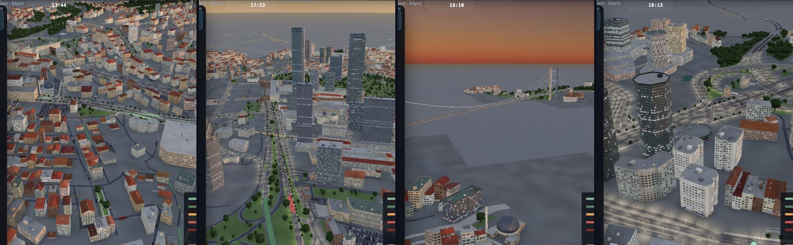
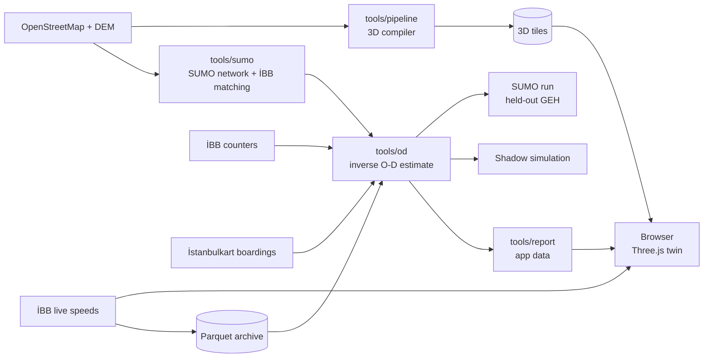

<div align="center">

# Procedural Istanbul

**An open traffic digital twin of Istanbul that runs in the browser, and a traffic model that reads demand from road speeds.**

[**Live 3D twin**](https://aaasiroglu.github.io/procedural-istanbul/app/) · [**Project site**](https://aaasiroglu.github.io/procedural-istanbul/) · [Technical report (TR)](docs/rapor/teknik_rapor.pdf) · [Slides](docs/sunum/README.md) · [Türkçe](README.tr.md)

[](https://github.com/aaasiroglu/procedural-istanbul/actions/workflows/ci.yml)
[](https://aaasiroglu.github.io/procedural-istanbul/)


[](LICENSE)



</div>

Procedural Istanbul covers the **Maslak – Levent – Mecidiyeköy – Beşiktaş – 15 July Bridge** corridor, one of the busiest in Istanbul, and is built entirely from open data. It has two halves:

- **A 3D city in the browser.** About 38,000 buildings, 1,170 km of roads, bridges, trees and street furniture are compiled from OpenStreetMap and elevation data into streamed tiles and rendered in real time with Three.js. Roads are coloured by İBB's live congestion feed. Cars move with it, including stop-and-go on jammed roads.
- **A traffic model underneath it.** İBB, the Istanbul Metropolitan Municipality, publishes speeds, not vehicle counts. The model estimates the origin–destination (O-D) demand from those speeds:
  - it uses each speed only as a one-sided bound;
  - it reports for every number how much comes from data and how much from assumptions;
  - it is validated on counts it has never seen;
  - it is tested dynamically in [SUMO](https://eclipse.dev/sumo/).

The 3D engine is derived from Yong Su's [Tokyo](https://github.com/jeantimex/tokyo) project (MIT). The Istanbul data pipeline, the transport model, the analytics and the app are developed in this repository.

## Try it

| | |
|---|---|
| **No install** | Open the [live 3D twin](https://aaasiroglu.github.io/procedural-istanbul/app/). İBB's traffic feed is refreshed every hour by the site's build. Use **Recommendations** and **O-D zones** in the top bar. |
| **Run the published build locally** | `npx serve docs` → http://localhost:3000/app/ (the compiled city is committed under `docs/app`) |
| **Reproduce the O-D estimate** | `npm run reproduce`: the reference estimate from the committed data snapshot, checked against its expected numbers (Python + uv, about 5 minutes, no downloads) |
| **Develop the client** | see [Quick start](#quick-start) |

## What is in it

| Area | What it does | Where |
|---|---|---|
| 3D city compiler | OSM + DEM → binary tiles (buildings, roads, bridges, rails, props, signs) | [`tools/pipeline`](tools/pipeline) |
| 3D client | Streaming, lighting and atmosphere, traffic, live İBB layer, recommendations and O-D zone panels | [`src/`](src) |
| SUMO network | OSM → SUMO network, İBB segment matching (95.5 %), smoke tests | [`tools/sumo`](tools/sumo/README.md) |
| Inverse O-D estimator | Censored speed observations, bilevel MAP with UE assignment, data share, level identification | [`tools/od/odme.py`](tools/od/odme.py) |
| Real-corridor estimate | Zones (H3 + gateways), land-use prior, İBB counts, İstanbulkart anchor | [`tools/od`](tools/od/README.md) |
| Shadow simulation | Saves SUMO's state at an incident and races response policies faster than real time | [`tools/sumo/shadow.py`](tools/sumo/shadow.py) |
| App data export | Estimate → zones, O-D pairs, bottlenecks, recommendations for the client | [`tools/report/export_app_data.py`](tools/report/export_app_data.py) |
| Live data archive | İBB speeds every 5 minutes as Parquet | [`tools/archive`](tools/archive/README.md) |



## Quick start

Requirements: **Node.js 20+**, and for the transport model **Python 3.10+** with [uv](https://docs.astral.sh/uv/).

```bash
git clone https://github.com/aaasiroglu/procedural-istanbul.git
cd procedural-istanbul
npm install
node tools/assets/fetch_textures.mjs        # CC0 textures, once
npm run fetch -- --area=koridor             # OSM and elevation data
npm run compile -- --area=koridor           # 3D tiles into public/tiles/koridor (needs > 4 GB RAM)
npm run dev                                 # http://localhost:5280/?area=koridor
```

The dev server proxies İBB's live feed (`/api/ibb-*`), so live colours work locally. Useful URL parameters: `?guide=0` hides the welcome card, `?recs=1` opens the recommendations, `?zones=1` shows the O-D zones, `?cam=x,z,dist,azimuth,elevation` sets the view, `?time=17.5` fixes the clock.

Transport model (SUMO 1.27 is installed into the project environment by uv on first use). To get the reference result without building anything, start from the snapshot:

```bash
npm run reproduce                           # data/snapshot/koridor → estimate, compared with expected.json
```

The snapshot holds every input of the reference estimate, frozen on 19 October 2026 at 11:30: the SUMO network, the İBB segment matching, the land-use extract, İBB's speeds, the October 2024 counts and the İstanbulkart anchor (about 12 MB). To build the same from today's data:

```bash
npm run sumo:net -- --area=koridor          # OSM → SUMO network (data/sumo/koridor)
npm run sumo:map-ibb -- --area=koridor      # İBB segments → SUMO edges
npm run od:corridor -- --area=koridor       # O-D estimate from live speeds
uv run --group sumo python tools/report/export_app_data.py   # estimate → public/data/od/koridor.json for the app
uv run --group sumo python tools/sumo/shadow.py --area=koridor --narrate
```

Every command, with counts and anchors, is listed in [the technical report, appendix A](docs/rapor/teknik_rapor.pdf). Behind a corporate TLS proxy, set `UV_NATIVE_TLS=1`.

## Tests

```bash
npm test          # 3D data pipeline (compiled-tile checks are skipped when no tiles are present)
npm run test:od   # inverse O-D estimator on a synthetic city with a known answer (34 checks)
npm run build     # client bundle
npm run reproduce # reference O-D estimate from the snapshot, within tolerance of expected.json
```

CI runs all four on every push ([`ci.yml`](.github/workflows/ci.yml)). [`pages.yml`](.github/workflows/pages.yml) publishes `docs/` hourly with a fresh İBB snapshot.

## Results so far, honestly

- **Synthetic city:** on links nobody counted, the error falls from GEH 5.6 to 2.2. 96 % of true values lie within 2.5 standard errors. Single O-D cells are not identifiable, and the model says so.
- **Real corridor:** 23 İBB counters anchor the total level of demand (data share 0.81). The land-use prior had almost **twice** the cars the counts allow.
- **Not yet:** on held-out counters, only about 9 % reach GEH < 5 against a target of 85 %. The total is right, but the spread across zones is weak. Several counters probably count one direction only; İBB has to confirm this.
- **Shadow simulation:** when a TEM motorway stretch closes, warning drivers at once gets 735 more cars through in 20 minutes. This is a single run, and part of the gain comes from more frequent re-routing.

Details, negative findings included: [`tools/od/README.md`](tools/od/README.md), [`tools/sumo/README.md`](tools/sumo/README.md) and the [technical report](docs/rapor/teknik_rapor.pdf).

## Repository layout

```text
src/world, src/shared   3D engine, traffic, live İBB layer, panels (Three.js)
tools/pipeline          OSM / İBB / DEM → 3D tiles (Node.js)
tools/sumo              SUMO network, İBB matching, dynamic runs, shadow simulation (Python)
tools/od                inverse O-D estimate, UE assignment, anchors, sensor audit, neural solver (Python)
tools/report            figures and the app's data export (Python)
tools/archive           İBB live data archive (Python)
data/snapshot           frozen inputs of the reference estimate (npm run reproduce)
docs/                   project site (GitHub Pages), docs/app = published 3D build, report and slides
```

## Contributing

Contributions are welcome: code, data checks, documentation or issues. Start with [CONTRIBUTING.md](CONTRIBUTING.md); it has setup notes, conventions and a list of good first tasks. Please follow the [code of conduct](CODE_OF_CONDUCT.md).

## Citing

If you use the method or the data pipeline, please cite it as described in [CITATION.cff](CITATION.cff) (GitHub shows a "Cite this repository" button).

## License and data

Code: [MIT](LICENSE), © 2026 Abdurrahim Arif Aşıroğlu (Istanbul data pipeline, transport model, analytics, app) and © 2026 Yong Su (original 3D engine).

Data and assets:
- roads and buildings © OpenStreetMap contributors (ODbL)
- traffic data © İBB Open Data and UYM
- elevation from Mapzen terrain tiles (SRTM and others)
- textures from Poly Haven (CC0)
- ez-tree and takram three-geospatial (MIT)
