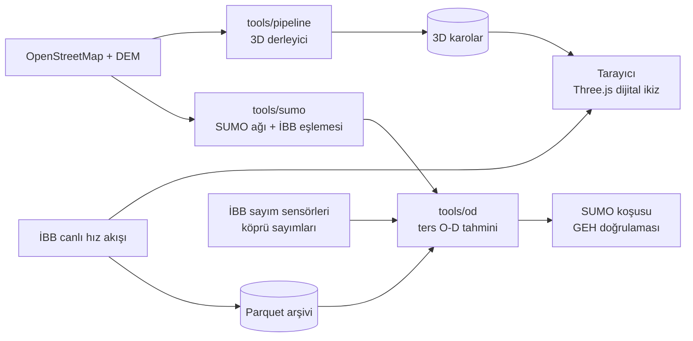

<div align="center">

# Procedural Istanbul

**Gerçek veriyle beslenen, tarayıcıda çalışan İstanbul trafik dijital ikizi**
<br>*A browser-based traffic digital twin of Istanbul, driven by live open data*


</div>

**Maslak – Levent – Mecidiyeköy – Çağlayan – Beşiktaş – 15 Temmuz Köprüsü** koridorunun tarayıcıda çalışan 3D dijital ikizi. Amaç, koridordaki trafiği gerçek veriyle simüle etmek, literatüre dayalı olarak sınıflandırmak ve iki ayrı kitleye öneri üretmek: **sürücü/yolcu** ile **belediye/trafik uzmanı**.

3D motor, Yong Su'nun [Tokyo](https://github.com/jeantimex/tokyo) projesinden (MIT) türetilmiştir. İstanbul verisi, ulaşım modeli ve analitik katman bu repoda geliştirilmektedir.

## In short (English)

- **A city from open data.** About 38,000 buildings, 1,170 km of roads, 60 bridge decks, trees, street furniture and signage are compiled from OpenStreetMap and elevation tiles into streamed 3D tiles. The result runs in real time in the browser (Three.js, physically based atmosphere).
- **Live traffic.** İBB's live feed of more than 6,000 road segments is drawn on the network as it updates.
- **A real simulator behind it.** The corridor is rebuilt as a SUMO network: 21k edges, 293 signalised junctions, the bridge and the Metrobüs busway. 95 % of İBB's segments are matched to SUMO edges.
- **Research contribution: demand from speeds.** İBB reports speeds, not vehicle counts. The inverse OD estimator treats each speed as a *censored* observation: free flow gives an upper bound, a queue gives a lower bound. It runs bilevel with user-equilibrium assignment and reports, for every OD pair, how much of the estimate comes from data and how much from the prior. Validation uses GEH on **held-out** counts only.
- **Honest about what is not known.** Panels that still show illustrative values are labelled as such, negative results are reported, and the total demand level carries its own identification measure.

Slides (TR / EN): [docs/sunum](docs/sunum/README.md)

## Mimari



## Neyi farklı yapıyor

Projenin araştırma katkısı, **hız verisinden talep (O-D) matrisi çıkarma** problemine yaklaşımıdır. İBB'nin canlı akışı her yol kesimi için hız ve sıkışıklık sınıfı verir, araç sayısı vermez. Gerçek sayımlar azdır (ör. köprü geçişleri). Bu yapı, hız verisini olduğundan daha kesin göstermeden kullanmaya dayanır.

| Fikir | Ne demek | Durum |
|---|---|---|
| **Hız = sansürlü gözlem** | Üçgen temel diyagramda serbest akış hızındaki bir yol 0 ile kapasite arasında herhangi bir akımı taşıyabilir. Bu yüzden hız sadece *üst sınır* verir. Ancak sıkışık daldaki hız bir akım verir, kuyruk da talebin bunu aştığını gösterir; bu durumda hız *alt sınır* olur. Hızlar sahte sayıma çevrilmez, tek taraflı kısıt olarak modele girer. | ✅ `tools/od/odme.py` |
| **Veri payı** | Her O-D çifti için tahminin ne kadarının veriden, ne kadarının varsayımdan (prior) geldiği hesaplanır (Laplace yaklaşımı, standart hata). Veriyle belirlenemeyen talep açıkça işaretlenir. | ✅ |
| **Dürüst doğrulama** | GEH, modelin uydurulduğu sayımlarda değil, **dışarıda bırakılan** sayımlarda ölçülür (çapraz doğrulama). Prior ağırlığı da bu skorla seçilir. | ✅ |
| **Bilevel tahmin** | Rota seçimi talebe bağlıdır. UE ataması ile tahmin dönüşümlü çalışır, salınım ardışık ortalamalarla (MSA) sönümlenir. | ✅ |
| **Çok kaynaklı çapalar** | Köprü geçiş sayıları (kesin), İstanbulkart saatlik binişleri (mod payı) ve İBB hızları (sansürlü) aynı tahmine girer. | Planlandı |
| **Simülasyondan gerçeğe ters çözücü** | SUMO ile üretilen binlerce (O-D → hız) örneğiyle eğitilen bir sinir ağı, canlı hızdan O-D'yi anlık tahmin eder. Yukarıdaki tahminci bu ağın referansı ve denetçisi olur. | Araştırma |
| **Gölge simülasyon** | Kaza veya kapanma anında SUMO durumu çatallanır ve birkaç müdahale politikası gerçek zamandan hızlı koşturulup karşılaştırılır. Kararı simülasyon verir, dil modeli yalnızca sonucu anlatır. | Planlandı |
| **Matrakçı görünümü** | Koridorun Matrakçı Nasuh minyatür kartografyasından esinlenen alternatif çizimi (`src/matrakci`). | Prototip |

Gerçek O-D'si bilinen sentetik bir şehirde (`npm run test:od`) linklerin %30'u sayıldı, kalanlarda yalnızca hız kullanıldı. Tahminci, hiç sayılmayan linklerin ortalama akım hatasını prior'a göre **GEH 5.6'dan 2.2'ye** (rotalar biliniyorken) ve **3.8'e** (rotalar da tahmin edilirken) indiriyor. Rotaları prior'a sabitleyen kısa yol GEH 8.0 veriyor. Gerçek değerlerin %96'sı 2.5 standart hata içinde kalıyor. Tek tek O-D hücrelerindeki kazanç ise küçük ve bu açıkça raporlanıyor: 36 sayımla 90 O-D çifti tam belirlenemez.

Ara sonuç sunumu (yöntem, sentetik ve gerçek veri sonuçları, olumsuz bulgular, yol haritası): [docs/sunum](docs/sunum/README.md).

## Durum

| Katman | Durum |
|---|---|
| 3D şehir (yollar, binalar, arazi, atmosfer) | Çalışıyor. Bina yükseklikleri OSM'den, etiket yoksa varsayılan kat sayısından geliyor |
| İBB canlı hız akışı | Çalışıyor (yalnızca `npm run dev` proxy'siyle) |
| İBB hız arşivi | ✅ 5 dakikada bir Parquet (`npm run archive:ibb`) |
| SUMO ağı | ✅ OSM'den koridor ağı; köprü, metrobüs ayrık şeridi, 293 sinyalli kavşak; İBB segmentlerinin %95.5'i kenarlara eşlendi ([tools/sumo](tools/sumo/README.md)) |
| Ters O-D tahmini | ✅ Canlı İBB hızlarından koridorun ilk O-D tahmini (75 H3 zonu ve 20 geçit, SUMO `od2trips` çıktısı). Talep düzeyi sayım olmadan belirlenemiyor ([tools/od](tools/od/README.md)) |
| Tarayıcıdaki trafik | Görsel: araçlar kameranın çevresinde, rotalar rastgele. Analiz için kullanılmamalı |
| Panellerdeki H3 / tahmin / maliyet değerleri | **Gösterim amaçlı**, elle girilmiş sabitler. Veriden hesaplanmıyor |
| Talep, kalibrasyon, öneri motoru | Planlandı |

## Yol haritası

1. **Kapsam ve arşiv:** Koridor sınırı ✅, canlı hız arşivi ✅
2. **Ağ:** OSM'den SUMO ağı ✅, İBB segment eşlemesi ✅. Duman testindeki kilitlenme noktaları ile Zincirlikuyu örgülenmesi ve Mecidiyeköy viyadüğü netedit ile doğrulanacak
3. **Talep:** İlk O-D tahmini ✅. Sırada köprü sayımlarıyla talep düzeyinin sabitlenmesi, hold-out GEH raporu ve tahminin SUMO'da koşturulması var
4. **Sınıflandırma:** HCM LOS, tekrarlayan ve tekrarlamayan tıkanıklık, darboğaz aktivasyonu
5. **3D:** Tarayıcı SUMO yörüngelerini oynatır, köprü gerçek ölçüleriyle modellenir
6. **Öneriler:** Sürücüye kalkış saati, mod ve köprü seçimi; uzmana darboğaz sıralaması ve senaryo karşılaştırması

## Çalıştırma

Gereksinimler: Node.js 20+, Python 3.10+ ve [uv](https://docs.astral.sh/uv/).

```bash
npm install
node tools/assets/fetch_textures.mjs        # CC0 dokular, bir kez
npm run fetch -- --area=koridor             # OSM ve DEM
npm run compile -- --area=koridor           # 3D karolar (public/tiles/koridor)
npm run dev                                 # http://localhost:5280/?area=koridor
```

Simülasyon tarafı (SUMO 1.27, `uv` ilk çalıştırmada projenin ortamına kurar):

```bash
npm run sumo:net -- --area=koridor          # OSM → SUMO ağı (data/sumo/koridor)
npm run sumo:map-ibb -- --area=koridor      # İBB segmentleri → SUMO kenarları
npm run sumo:smoke -- --area=koridor        # kilitlenme / teleport testi
npm run od:corridor -- --area=koridor       # canlı hızlardan O-D tahmini
```

Kurumsal bir TLS vekil sunucusunun arkasındaysanız `uv`'nin sistem sertifikalarını kullanması için `UV_NATIVE_TLS=1` tanımlayın.

Genişletilmiş koridor eskisinin yaklaşık altı katı büyüklükte. Derleme 4 GB'tan fazla bellek isteyebilir.

```bash
npm run archive:ibb                         # İBB canlı hızlarını data/archive/ibb altına arşivler
npm test                                    # 3D veri hattı testleri
npm run test:od                             # ters O-D testleri
```

Arşivin yapısı ve sorgu örnekleri için bkz. [tools/archive/README.md](tools/archive/README.md).

## Yapı

```text
src/world, src/shared   3D motor ve tarayıcı arayüzü
src/matrakci            Matrakçı görünümü
tools/pipeline          OSM / İBB / DEM → 3D karolar
tools/archive           İBB canlı veri arşivi (Python)
tools/od                Ters O-D tahmini ve UE ataması (Python)
tools/sumo              SUMO ağı, İBB segment eşlemesi, duman testi (Python)
```

`GEO_TWIN_MIMARISI.md` ve `METODOLOJI_VE_MIMARI.md` hedef mimariyi anlatır. Anlattıkları her şey henüz uygulanmış değildir.

## Lisans ve kaynaklar

Kod MIT lisanslıdır (© 2026 Yong Su ve katkıcılar). Kullanılan veri ve varlıklar:

- Yol ve bina verisi: © OpenStreetMap katkıcıları (ODbL)
- Trafik verisi: © İBB Açık Veri ve UYM
- Varlıklar: Poly Haven (CC0), ez-tree ve takram three-geospatial (MIT)
