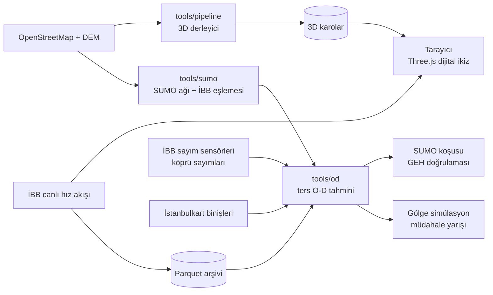

<div align="center">

# Procedural Istanbul

**Gerçek veriyle beslenen, tarayıcıda çalışan İstanbul trafik dijital ikizi**
<br>[English](README.md) · **Türkçe**


</div>

**Maslak – Levent – Mecidiyeköy – Çağlayan – Beşiktaş – 15 Temmuz Köprüsü** koridorunun tarayıcıda çalışan 3D dijital ikizi. Amaç, koridordaki trafiği gerçek veriyle simüle etmek, literatüre dayalı olarak sınıflandırmak ve iki ayrı kitleye öneri üretmek: **sürücü/yolcu** ile **belediye/trafik uzmanı**.

3D motor, Yong Su'nun [Tokyo](https://github.com/jeantimex/tokyo) projesinden (MIT) türetilmiştir. İstanbul verisi, ulaşım modeli ve analitik katman bu repoda geliştirilmektedir.

**Live 3D twin:** https://aaasiroglu.github.io/procedural-istanbul/app/ · **Project site:** https://aaasiroglu.github.io/procedural-istanbul/ · **Technical report (TR, PDF):** [docs/rapor/teknik_rapor.pdf](docs/rapor/teknik_rapor.pdf) · **Slides (TR / EN):** [docs/sunum](docs/sunum/README.md)

## Mimari



## Neyi farklı yapıyor

Projenin araştırma katkısı, **hız verisinden talep (O-D) matrisi çıkarma** problemine yaklaşımıdır. İBB'nin canlı akışı her yol kesimi için hız ve sıkışıklık sınıfı verir, araç sayısı vermez. Gerçek sayımlar azdır (ör. köprü geçişleri). Bu yapı, hız verisini olduğundan daha kesin göstermeden kullanmaya dayanır.

| Fikir | Ne demek | Durum |
|---|---|---|
| **Hız = sansürlü gözlem** | Üçgen temel diyagramda serbest akış hızındaki bir yol 0 ile kapasite arasında herhangi bir akımı taşıyabilir. Bu yüzden hız sadece *üst sınır* verir. Ancak sıkışık daldaki hız bir akım verir, kuyruk da talebin bunu aştığını gösterir; bu durumda hız *alt sınır* olur. Hızlar sahte sayıma çevrilmez, tek taraflı kısıt olarak modele girer. | ✅ `tools/od/odme.py` |
| **Veri payı** | Her O-D çifti için tahminin ne kadarının veriden, ne kadarının varsayımdan (prior) geldiği hesaplanır (Laplace yaklaşımı, standart hata). Veriyle belirlenemeyen talep açıkça işaretlenir. | ✅ |
| **Dürüst doğrulama** | GEH, modelin uydurulduğu sayımlarda değil, **dışarıda bırakılan** sayımlarda ölçülür (çapraz doğrulama). Prior ağırlığı da bu skorla seçilir. | ✅ |
| **Bilevel tahmin** | Rota seçimi talebe bağlıdır. UE ataması ile tahmin dönüşümlü çalışır, salınım ardışık ortalamalarla (MSA) sönümlenir. | ✅ |
| **Çok kaynaklı çapalar** | Köprü geçiş sayıları (kesin), İstanbulkart saatlik binişleri (mod payı) ve İBB hızları (sansürlü) aynı tahmine girer. Çapalar link yerine doğrudan O-D toplamlarını kısıtlar (`od_sum`). İstanbulkart çapası yalnızca kaba bir makullük kontrolü: biniş/otomobil oranı varsayım olduğu için sayımları doğrulamıyor, sadece aynı büyüklükte olduklarını gösteriyor. | ✅ `tools/od/anchors.py` |
| **Simülasyondan gerçeğe ters çözücü** | SUMO ile üretilen binlerce (O-D → hız) örneğiyle eğitilen bir sinir ağı, canlı hızdan O-D'yi anlık tahmin eder. Yukarıdaki tahminci bu ağın referansı ve denetçisi olur. İlk sürüm statik atama örnekleriyle eğitildi ve denetçi onu reddetti (simülasyon-gerçek farkı); SUMO örnekleri sırada. | İlk sürüm `tools/od/neural_inverse.py` |
| **Gölge simülasyon** | Kaza veya kapanma anında SUMO durumu çatallanır ve birkaç müdahale politikası gerçek zamandan hızlı koşturulup karşılaştırılır. Kararı simülasyon verir, dil modeli yalnızca sonucu anlatır. İlk sınamada TEM kapanmasında anında bilgilendirme, habersiz duruma göre 735 araç daha geçirdi (dört koşu ~9 dakikada). | ✅ İlk sürüm `tools/sumo/shadow.py` |
| **Talep düzeyinin tanımlanabilirliği** | Tüm matrisin düzeyi ayrı bir çarpanla taşınır; profil eğriliğinden sayımların düzeyi gerçekten sabitleyip sabitlemediği ölçülür. Gerçek koridorda 23 sayım düzeyi sabitliyor (veri payı 0.81) ve prior'ın toplam talebi neredeyse iki kat yüksek gösterdiğini ortaya koyuyor (117.9 bin → 61.6 bin araç/sa). | ✅ |

Gerçek O-D'si bilinen sentetik bir şehirde (`npm run test:od`) linklerin %30'u sayıldı, kalanlarda yalnızca hız kullanıldı. Tahminci, hiç sayılmayan linklerin ortalama akım hatasını prior'a göre **GEH 5.6'dan 2.2'ye** (rotalar biliniyorken) ve **3.8'e** (rotalar da tahmin edilirken) indiriyor. Rotaları prior'a sabitleyen kısa yol GEH 8.0 veriyor. Gerçek değerlerin %96'sı 2.5 standart hata içinde kalıyor. Tek tek O-D hücrelerindeki kazanç ise küçük ve bu açıkça raporlanıyor: 36 sayımla 90 O-D çifti tam belirlenemez.

Ara sonuç sunumu (yöntem, sentetik ve gerçek veri sonuçları, olumsuz bulgular, yol haritası): [docs/sunum](docs/sunum/README.md).

## Durum

| Katman | Durum |
|---|---|
| 3D şehir (yollar, binalar, arazi, atmosfer) | Çalışıyor. Bina yükseklikleri OSM'den, etiket yoksa varsayılan kat sayısından geliyor |
| İBB canlı hız akışı | Çalışıyor (yalnızca `npm run dev` proxy'siyle) |
| İBB hız arşivi | ✅ 5 dakikada bir Parquet (`npm run archive:ibb`) |
| SUMO ağı | ✅ OSM'den koridor ağı; köprü, metrobüs ayrık şeridi, 293 sinyalli kavşak; İBB segmentlerinin %95.5'i kenarlara eşlendi ([tools/sumo](tools/sumo/README.md)) |
| Ters O-D tahmini | ✅ Canlı İBB hızlarından koridorun ilk O-D tahmini (75 H3 zonu ve 20 geçit, SUMO `od2trips` çıktısı). İBB sayımlarıyla talep düzeyi sabitlendi (×0.30, veri payı 0.81); dışarıda bırakılan GEH < 5 oranı %8.7, dağılım hâlâ zayıf ([tools/od](tools/od/README.md)) |
| Tarayıcıdaki trafik | Görsel: araçlar kameranın çevresinde, rotalar rastgele. Analiz için kullanılmamalı |
| Panellerdeki H3 zonları, O-D akışları, öneriler | ✅ **Gerçek veri:** tahminin 95 zonu ve 1.470 O-D çifti, İBB hızları, darboğazlar ve kural tabanlı öneri motoru v1 (`tools/report/export_app_data.py` → `public/data/od/koridor.json`) |
| Çok kaynaklı çapalar, gölge simülasyon, sinir ağı ters çözücü | İlk sürümler ([teknik rapor](docs/rapor/teknik_rapor.pdf)) |
| Öneri motoru | İlk sürüm: darboğaz sıralaması, kaza müdahalesi (gölge simülasyon), teyit edilecek sensörler, talep düzeyi |

## Yol haritası

1. **Kapsam ve arşiv:** Koridor sınırı ✅, canlı hız arşivi ✅
2. **Ağ:** OSM'den SUMO ağı ✅, İBB segment eşlemesi ✅. Duman testindeki kilitlenme noktaları ile Zincirlikuyu örgülenmesi ve Mecidiyeköy viyadüğü netedit ile doğrulanacak
3. **Talep:** İlk O-D tahmini ✅, talep düzeyinin sayımlarla sabitlenmesi ✅, dışarıda bırakılan GEH raporu ✅, İstanbulkart çapası ✅. Sırada zonlar arası dağılım (anket mod payı, KGM köprü yön sayımları) ve sabitlenmiş talebin SUMO'da kilitlenmeden koşması var
4. **Sınıflandırma:** HCM LOS, tekrarlayan ve tekrarlamayan tıkanıklık, darboğaz aktivasyonu
5. **3D:** Tarayıcı SUMO yörüngelerini oynatır, köprü gerçek ölçüleriyle modellenir
6. **Öneriler:** Sürücüye kalkış saati, mod ve köprü seçimi; uzmana darboğaz sıralaması ve senaryo karşılaştırması

## Çalıştırma

Gereksinimler: Node.js 20+, Python 3.10+ ve [uv](https://docs.astral.sh/uv/).

Referans O-D tahminini hiçbir şey indirmeden yeniden üretmek için:

```bash
npm run reproduce                           # data/snapshot/koridor → tahmin, expected.json ile karşılaştırılır
```

Anlık görüntü (`data/snapshot/koridor`, ~12 MB) tahminin tüm girdilerini 19 Ekim 2026 11:30'daki haliyle tutar: SUMO ağı, İBB segment eşlemesi, arazi kullanımı, İBB hızları, Ekim 2024 sayımları ve İstanbulkart çapası. CI her push'ta bunu koşturur.

3D istemci:

```bash
npm install
node tools/assets/fetch_textures.mjs        # CC0 dokular, bir kez
npm run fetch -- --area=koridor             # OSM ve DEM
npm run compile -- --area=koridor           # 3D karolar (public/tiles/koridor)
npm run dev                                 # http://localhost:5280/?area=koridor
```

Simülasyon tarafı (SUMO 1.27, `uv` ilk çalıştırmada projenin ortamına kurar):

```bash
npm run sumo:net -- --area=koridor          # OSM → SUMO ağı (data/sumo/koridor)
npm run sumo:map-ibb -- --area=koridor      # İBB segmentleri → SUMO kenarları
npm run sumo:smoke -- --area=koridor        # kilitlenme / teleport testi
npm run od:corridor -- --area=koridor       # canlı hızlardan O-D tahmini
uv run --group sumo python tools/sumo/shadow.py --area=koridor --narrate   # gölge simülasyon
```

Sayımlar, çapalar ve sinir ağı için tüm komutlar: [teknik rapor, Ek A](docs/rapor/teknik_rapor.pdf).

Kurumsal bir TLS vekil sunucusunun arkasındaysanız `uv`'nin sistem sertifikalarını kullanması için `UV_NATIVE_TLS=1` tanımlayın.

Genişletilmiş koridor eskisinin yaklaşık altı katı büyüklükte. Derleme 4 GB'tan fazla bellek isteyebilir.

```bash
npm run archive:ibb                         # İBB canlı hızlarını data/archive/ibb altına arşivler
npm test                                    # 3D veri hattı testleri
npm run test:od                             # ters O-D testleri
npm run reproduce                           # referans tahmin, anlık görüntüden
```

Arşivin yapısı ve sorgu örnekleri için bkz. [tools/archive/README.md](tools/archive/README.md).

## Yapı

```text
src/world, src/shared   3D motor ve tarayıcı arayüzü
tools/pipeline          OSM / İBB / DEM → 3D karolar
tools/archive           İBB canlı veri arşivi (Python)
tools/od                Ters O-D tahmini, UE ataması, çapalar, sinir ağı (Python)
tools/sumo              SUMO ağı, İBB eşlemesi, dinamik koşu, gölge simülasyon (Python)
data/snapshot           Referans tahminin dondurulmuş girdileri (npm run reproduce)
docs/rapor, docs/sunum  Teknik rapor (PDF) ve sunumlar (TR / EN)
```

## Lisans ve kaynaklar

Kod MIT lisanslıdır (© 2026 Yong Su ve katkıcılar). Kullanılan veri ve varlıklar:

- Yol ve bina verisi: © OpenStreetMap katkıcıları (ODbL)
- Trafik verisi: © İBB Açık Veri ve UYM
- Varlıklar: Poly Haven (CC0), ez-tree ve takram three-geospatial (MIT)
