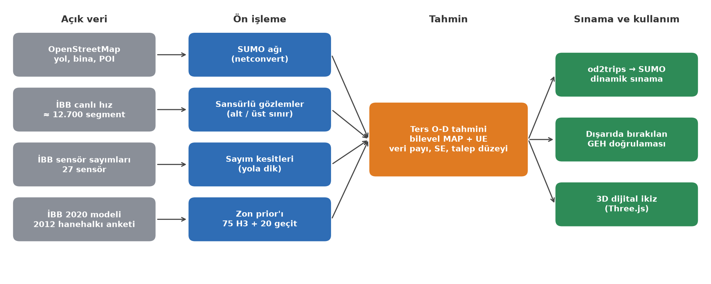
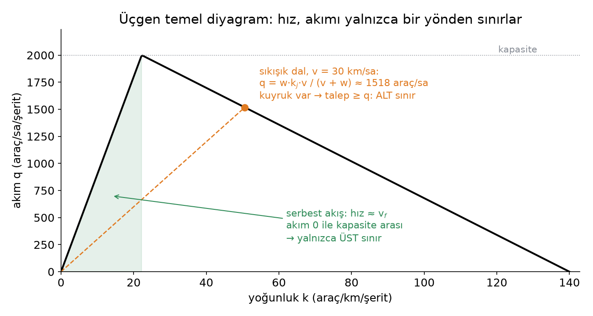
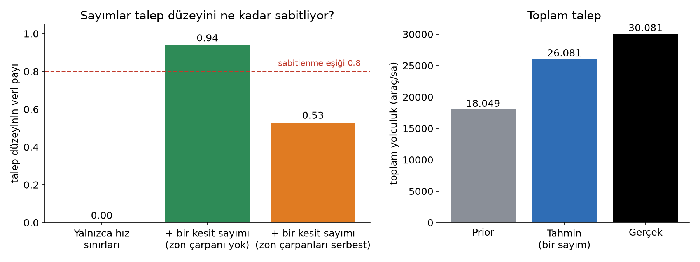
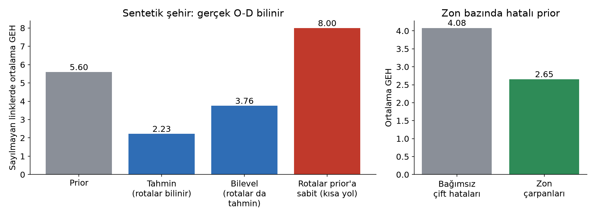
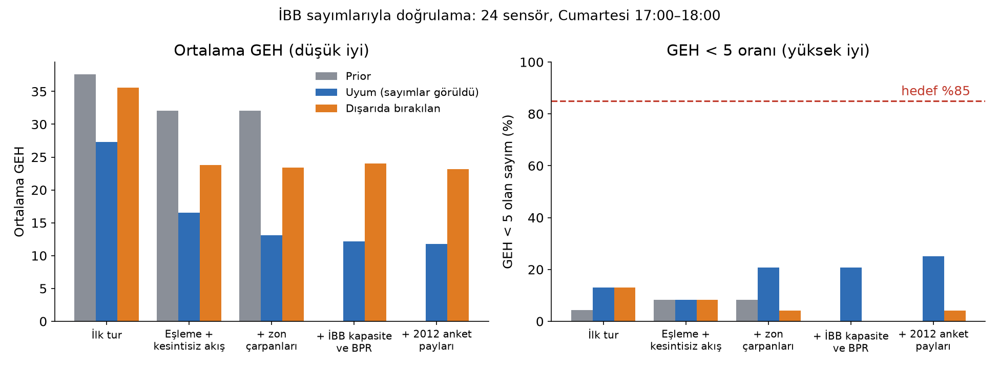
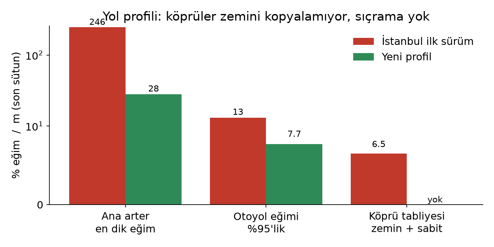

<!-- _class: title -->
<!-- _paginate: false -->

# Procedural Istanbul

### Sansürlü hız gözlemleriyle O-D tahmini ve Maslak–15 Temmuz koridorunun açık dijital ikizi

<br>

**Abdurrahim Arif Aşıroğlu**
Ara sonuç sunumu · Ekim 2026

<span class="small" style="color:#cfe2f7">github.com/aaasiroglu/procedural-istanbul (MIT) · 3D motor, Yong Su'nun "Tokyo" projesinden türetilmiştir</span>

---

## Koridor: Maslak – Levent – Mecidiyeköy – Beşiktaş – 15 Temmuz Köprüsü

<div class="cols">
<div class="center">


</div>
<div>

- Tarayıcıda çalışan **3D dijital ikiz**: yollar, binalar ve arazi tamamen açık veriden (OpenStreetMap, SRTM) derleniyor.
- Yol kesimleri İBB'nin **canlı sıkışıklık sınıfıyla** renkleniyor (serbest → çok yoğun).
- Altında bir **ulaşım modeli** çalışıyor: SUMO ağı, ters O-D tahmini ve İBB sayımlarıyla doğrulama.
- Araştırma sorusu: **yalnızca hız ölçen bir sensör ağından, bir simülatörün ihtiyaç duyduğu talep matrisi ne kadar güvenilir çıkarılabilir?**

</div>
</div>

---

## Problem

- **Simülatör yolculuk ister, sensör hız verir.** SUMO gibi bir simülatör başlangıç–varış (O-D) matrisine, yani kimin nereden nereye gittiğine ihtiyaç duyar. İBB'nin canlı akışı ise her yol kesimi için yalnızca **hız** ve **sıkışıklık sınıfı** verir.
- **Sayım az, problem kötü konumlanmış.** 9.025 O-D çifti, eldeki gözlemlerin yüzlerce katı. Veri tek başına matrisi belirleyemez.
- **Yaygın yaklaşımın zaafı.** Hızı sahte sayıma çevirmek, verinin taşımadığı bir kesinliği modele sokar. Tahminin ne kadarının veriden, ne kadarının varsayımdan geldiği çoğu çalışmada raporlanmaz.

<div class="note">

**Amaç:** Koridorun saatlik O-D matrisini açık veriden tahmin etmek, belirsizliği açıkça raporlamak ve sonucu modelin görmediği sayımlarla doğrulamak.

</div>

---

## Çalışma alanı ve veri

<div class="cols">
<div>


</div>
<div>

**Alan:** Beşiktaş – Maslak ve Çağlayan – 15 Temmuz Köprüsü (≈ 5,9 × 8,9 km)

| Veri | Kaynak |
|---|---|
| Yol ağı, binalar, POI | OpenStreetMap |
| Canlı segment hızı (≈ 12.700) | İBB UYM |
| Günlük sensör sayımı (27 sensör) | İBB Açık Veri |
| Saatlik prob araç yoğunluğu | İBB Açık Veri |
| Kalibre ulaşım modeli (2020) | İBB Açık Veri |
| Hanehalkı anketi (2012) | İBB Açık Veri |
| Sayısal yükseklik modeli | Mapzen / SRTM |

</div>
</div>

---

## Mimari



<span class="small">Her adım tek komutla yeniden üretilebilir (`npm run sumo:net`, `sumo:map-ibb`, `od:corridor`). Ters O-D yöntemi 32 sentetik kontrolle sınanıyor.</span>

---

<!-- _class: section -->

# 1 · Yöntem

---

## Katkı 1: Hız, sansürlü bir gözlemdir

<div class="cols">
<div>



</div>
<div>

- **Serbest akış hızı akımı belirlemez:** akım 0 ile kapasite arasında herhangi bir değer olabilir. Hız yalnızca **üst sınır** verir.
- **Sıkışık dalda** q = w·k<sub>j</sub>·v / (v + w). Kuyruk varsa talep geçen akımdan büyüktür; hız bu durumda **alt sınır** verir.
- Sıkışık ya da serbest kararını İBB'nin segment bazındaki **sıkışıklık sınıfı** verir.

</div>
</div>

$$\min_{x \ge 0} \sum_{\text{sayım}} \tfrac{((Px)_e - y_e)^2}{s_e^2} + \sum_{\text{alt}} \tfrac{\max(0,\, y_e - (Px)_e)^2}{s_e^2} + \sum_{\text{üst}} \tfrac{\max(0,\, (Px)_e - y_e)^2}{s_e^2} + \mathrm{KL}_\lambda(x \,\|\, x_0)$$

---

## Katkı 2: Belirsizlik ve dürüst doğrulama

- **Veri payı.** Her O-D çifti için tahminin veriden gelen kısmı: 1 − σ²<sub>sonsal</sub> / σ²<sub>prior</sub>. Laplace yaklaşımı; Woodbury özdeşliğiyle n × n yerine m × m çözüm.
- **İlişkili prior hataları.** x<sub>ij</sub> = x<sub>0,ij</sub> · e<sup>g + a<sub>i</sub> + b<sub>j</sub> + u<sub>ij</sub></sup>. Zon çarpanları (a<sub>i</sub>, b<sub>j</sub>) bir zonun tüm trafiğini tek sayıyla düzeltir; **g** tüm matrisin düzeyini taşır.
- **Dışarıda bırakılan doğrulama.** GEH, modelin uydurulduğu sayımlarda değil, her sayım tek tek dışarıda bırakıldığında ölçülür.
- **Bilevel tahmin.** UE ataması ile tahmin dönüşümlü çalışır; salınım ardışık ortalamalarla (MSA) sönümlenir (Spiess 1990; Yang ve ark. 1992).
- **Sayısal koşullanma.** Optimizasyon log-uzayda (z = x<sub>0</sub>·e<sup>u</sup>); prior değerleri 12 mertebeye yayılsa da L-BFGS yakınsar.

---

## Katkı 3: Talep düzeyi ne zaman sabitlenmiş sayılır?



- Düzeyin veri payı, profil amaç fonksiyonunun eğriliğinden hesaplanır: σ²<sub>g</sub> = 2 / f″(g), pay = 1 − σ²<sub>g</sub> / σ²<sub>prior</sub>.
- **Bulgu:** Zon çarpanları serbestken tek bir kesit sayımı düzeyin ancak **yarısını** belirliyor, çünkü sayım kestiği zonları büyüterek de karşılanabiliyor. Düzeyi sabitlemek için **bağımsız zonları kesen birden çok sayım** gerekir.

---

## Sentetik doğrulama: gerçek O-D'si bilinen şehir



- Sayılmayan linklerde ortalama GEH, prior'a göre **5,6'dan 2,2'ye** (rotalar biliniyorken) ve **3,8'e** (rotalar da tahmin edilirken) iniyor. Rotaları prior'a sabitlemek 8,0 veriyor; bilevel tahmin gerekli.
- Gerçek değerlerin **%96'sı 2,5 standart hata içinde**: belirsizlik aşırı iyimser değil.
- **Akımlar belirlenebiliyor, tek tek O-D hücreleri belirlenemiyor** (36 sayım, 90 çift). Bunu açıkça raporlamak katkının parçası.

---

<!-- _class: section -->

# 2 · Gerçek veri

---

## Sayım hattı ve eşleme denetimi

- 27 İBB sensöründen 25'i SUMO ağında yola dik **sayım kesitlerine** eşlendi (iki yön, tüm şeritler).
- **Günlükten saatliğe:** Aynı gün ve aynı geohash hücresindeki prob araçların saatlik payıyla. Cumartesi 17–18 için günün %3,6–5,1'i.

| Sensör | Günlük | İlk eşleme | Düzeltme |
|---|---|---|---|
| Mecidiyeköy | 110 bin | yan cadde (rota yok) | O-1 |
| Çağlayan Kavşağı | 103 bin | tek şeritli sokak | O-1 |
| TEM Karanfilköy | 103 bin | Uğur Mumcu Cd. | O-2 |
| FSM Gişeler | 81 bin | köprü girişiyle aynı kenarlar | çıkarıldı (yalnızca gişe şeritleri) |
| TEM FSM Gişe Öncesi | 98 bin | iki yön | tek yön |

<div class="note">

Sinyalli arterlerde düşük hız kırmızı ışıktan da gelir: buradaki alt sınırlar talebi %33 şişirdi. Kural yalnızca **kesintisiz akış** yollarıyla (otoyol, trunk) sınırlandı.

</div>

---

## GEH sonuçları: ilerleme var, ölçüt karşılanmıyor



**Dışarıda bırakılan ortalama GEH 35,6'dan 23,2'ye indi; ancak GEH < 5 ölçütü (%85) henüz uzak.**

---

## Kalan hata nereden geliyor?

<div class="cols">
<div>


</div>
<div>

1. **Sayım tanımları çelişiyor.** Üç O-2 sensörü modelde aynı akıma oturuyor; sayımları ise 4.291 / 7.108 / 8.171 araç/sa. Aralarında rampa yoksa bu mümkün değil: yön ya da şerit kapsamı farklı olmalı.
2. **Geçitler ve ağ.** FSM'de model, sayımın ancak yarısını taşıyabiliyor; geçit prior'ı kapasiteye dayalı kaba bir varsayım.
3. **Prior.** Link parametreleri (İBB 2020 kapasite ve BPR) darboğaz değil; 2012 anketinin yolculuk tipi payları küçük bir iyileşme getirdi.

</div>
</div>

---

## Dinamik sınama: SUMO

<div class="cols">
<div>


</div>
<div>

- Sayımsız tahmin: 128,6 bin araç/sa, 90 dk, mezoskopik model, dinamik yeniden rotalama.
- **Ağ kilitlendi:** 192.551 aracın 102.735'i girebildi; medyan hız 2,9 km/sa (İBB: 24 km/sa).
- Sayımla sabitlenmemiş talep düzeyinin aşırı yüksek olduğunu doğruluyor: köprüde sayım 8,5 bin, tahmin 13,9 bin araç/sa. Sayımlı tahmin 74 bin araç/sa.

</div>
</div>

<div class="note">

Bu sonuç, talep düzeyinin ayrıca ölçülmesini (Katkı 3) doğrudan motive ediyor.

</div>

---

<!-- _class: section -->

# 3 · 3D dijital ikiz

---

## Açık veriden prosedürel İstanbul

<div class="cols">
<div>


<span class="small">15 Temmuz Şehitler Köprüsü (kuleler, ana kablolar, askılar) ve Ortaköy Camii</span>

</div>
<div>


<span class="small">Levent: OSM `building:part` verisinden kuleler</span>

</div>
</div>

---

## İstanbul'a özgü kent dokusu

<div class="cols3">
<div class="center">


<span class="small">Kiremit kırma çatılar, bacalar, su depoları</span>

</div>
<div class="center">


<span class="small">Gerçek dükkân adlarıyla vitrin ve tabelalar</span>

</div>
<div class="center">


<span class="small">Zincirlikuyu: katmanlı kavşak ve viyadükler</span>

</div>
</div>

---

## Yol geometrisi

<div class="cols">
<div>



</div>
<div>

- **Köprüler:** Vadi ya da su geçen köprüler kıyıdan kıyıya düz tabliye.
- **Viyadükler:** Altındaki zemin artı katmana göre serbest yükseklik; dikey kurplarla yumuşatılmış.
- **Tüneller** ağızdan %12 eğimle derinleşir; yükseltilmiş yollar Chaikin yöntemiyle yuvarlatılır.
- **Performans:** 19,4 → 4,2 milyon üçgen; 4.599 → 780 çizim çağrısı.

</div>
</div>

---

## Sınırlar

- **Doğrulama ölçütü karşılanmıyor:** dışarıda bırakılan GEH < 5 oranı %4,2 (hedef %85).
- **Talep düzeyi kısmen belirli:** tek köprü sayımı, zon çarpanları serbestken düzeyin ancak yarısını sabitliyor.
- **Tek zaman dilimi:** yalnızca bir Cumartesi 17:00 görüntüsü; gün tipi ve saat değişkenliği henüz modellenmedi.
- **Statik atama:** dönüş yasakları ve kuyruk yayılımı yok.
- **Elle seçilmiş varsayımlar:** prior parametrelerinin tamamı `summary.json` içinde listeleniyor.
- **Literatür:** "hız = sansürlü gözlem" ve "veri payı" katkılarının özgünlüğü sistematik bir taramayla teyit edilmeli.

---

## Sonraki adımlar

1. **Sensör tanımları:** yön, şerit kapsamı ve gişe/rampa ayrımının İBB'den teyidi (çelişen O-2 sensörleri).
2. **Talep düzeyi:** köprünün iki yönü ayrı ve O-1, O-2 kesitleriyle birden çok bağımsız sayım; düzeyin veri payı ≥ 0,8.
3. **Zaman:** saatlik yoğunluk arşivinden gün tipi ve saat profilleri; canlı hız arşivinin sürekli çalışması.
4. **Dinamik tutarlılık:** sayımlı talebin SUMO'da ölçekli koşularla sınanması (%25 / %50 / %75 / %100).
5. **Öneri motoru:** sürücüye kalkış saati, mod ve köprü seçimi; kuruma darboğaz sıralaması ve senaryo karşılaştırması.

**Hedef yayın yolu:** TRB Annual Meeting / hEART (yöntem ve vaka), ardından *Transportation Research Part C* (çok haftalık doğrulama) ve açık veri seti makalesi.

---

## Yeniden üretilebilirlik

```bash
npm run sumo:net -- --area=koridor          # OSM → SUMO ağı
npm run sumo:map-ibb -- --area=koridor      # İBB segmentleri → kenarlar
uv run --group sumo python tools/od/counts.py --area=koridor --month=2024-10 --weekday=5 --hour=17
uv run --group sumo python tools/od/corridor.py --area=koridor \
    --speeds data/od/koridor/20261017-1726/speeds.csv \
    --counts data/od/koridor/counts_202410_d5_h17.csv --tag counts
npm run test:od                             # sentetik doğrulama (32 kontrol)
uv run --with matplotlib python tools/report/figures.py   # bu sunumun grafikleri (TR ve EN)
npm run dev                                 # 3D istemci: http://localhost:5280
```

Tüm varsayımlar, ara sonuçlar ve olumsuz bulgular `tools/*/README.md` dosyalarında tarih ve sayılarla kayıtlı.

---

## Kaynaklar

<div class="refs">

- Cascetta, E. (1984). Estimation of trip matrices from traffic counts and survey data: a generalized least squares estimator. *Transportation Research Part B*, 18(4–5).
- Chaikin, G. M. (1974). An algorithm for high-speed curve generation. *Computer Graphics and Image Processing*, 3(4).
- Daganzo, C. F. (1994). The cell transmission model. *Transportation Research Part B*, 28(4).
- Frederix, R., Viti, F., Corthout, R., Tampère, C. M. J. (2011). New gradient approximation method for dynamic origin–destination matrix estimation on congested networks. *Transportation Research Record*, 2263.
- Lopez, P. A. ve ark. (2018). Microscopic traffic simulation using SUMO. *IEEE ITSC*.
- Newell, G. F. (1993). A simplified theory of kinematic waves in highway traffic. *Transportation Research Part B*, 27(4).
- Spiess, H. (1990). A gradient approach for the O-D matrix adjustment problem. CRT, Université de Montréal.
- Van Zuylen, H. J., Willumsen, L. G. (1980). The most likely trip matrix estimated from traffic counts. *Transportation Research Part B*, 14(3).
- Yang, H., Sasaki, T., Iida, Y., Asakura, Y. (1992). Estimation of origin–destination matrices from link traffic counts on congested networks. *Transportation Research Part B*, 26(6).
- UK Department for Transport. TAG Unit M3.1, Highway Assignment Modelling (GEH ölçütü).
- İBB Açık Veri Portalı (data.ibb.gov.tr): Günlük Araç Sayımı, Saatlik Trafik Yoğunluk, Ulaşım Talep Tahmin Modeli Verisi.

</div>

---

<!-- _class: title -->
<!-- _paginate: false -->

# Teşekkürler

### Sorular ve geri bildirim

<br>

github.com/aaasiroglu/procedural-istanbul
