<!-- _class: title -->
<!-- _paginate: false -->

# Procedural Istanbul

### Origin–destination estimation from censored speed observations, and an open digital twin of the Maslak–15 July corridor

<br>

**Abdurrahim Arif Aşıroğlu**
Interim results · October 2026

<span class="small" style="color:#cfe2f7">github.com/aaasiroglu/procedural-istanbul (MIT) · 3D engine derived from Yong Su's "Tokyo" project</span>

---

## The corridor: Maslak – Levent – Mecidiyeköy – Beşiktaş – 15 July Bridge

<div class="cols">
<div class="center">

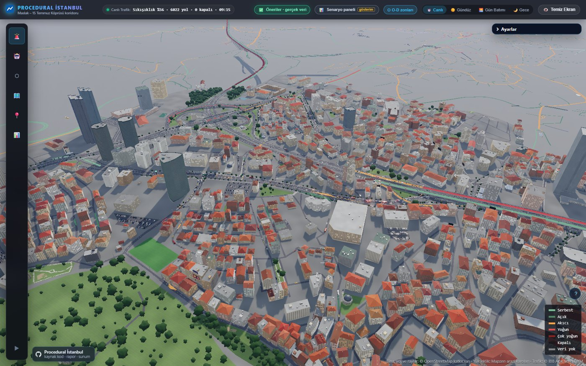

</div>
<div>

- A **3D digital twin** running in the browser: roads, buildings and terrain compiled entirely from open data (OpenStreetMap, SRTM).
- Road segments are coloured by İBB's **live congestion class** (free flow → very heavy).
- Underneath runs a **transport model**: a SUMO network, inverse OD estimation and validation against İBB counts.
- Research question: **how reliably can the demand matrix a simulator needs be inferred from a sensor network that measures only speed?**

</div>
</div>

---

## Problem

- **A simulator needs trips; sensors deliver speeds.** A simulator such as SUMO needs an origin–destination (OD) matrix: who travels from where to where. İBB's live feed gives each road segment only a **speed** and a **congestion class**.
- **Few counts, an ill-posed problem.** There are 9,025 OD pairs, hundreds of times more than the observations. The data alone cannot determine the matrix.
- **The weakness of the common approach.** Turning speeds into pseudo-counts injects a precision the data does not carry. Most studies do not report how much of an estimate comes from the data and how much from assumptions.

<div class="note">

**Aim:** estimate the corridor's hourly OD matrix from open data, report its uncertainty explicitly, and validate it against counts the model has not seen.

</div>

---

## Study area and data

<div class="cols">
<div>

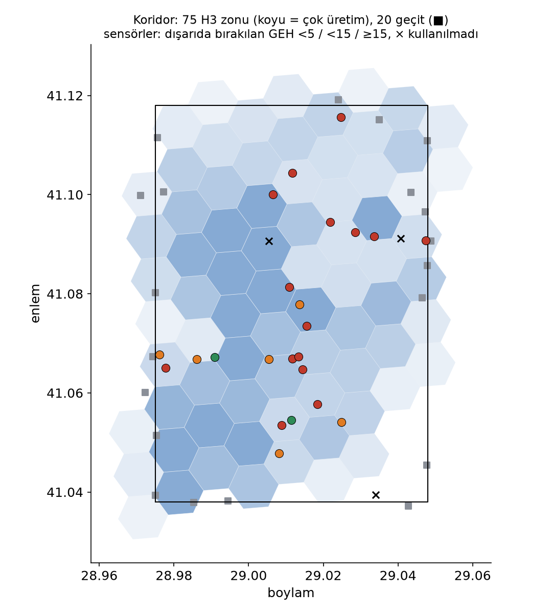
<span class="small">Labels in Turkish: H3 zones, gateways (■), sensors by held-out GEH.</span>

</div>
<div>

**Area:** Beşiktaş – Maslak and Çağlayan – 15 July Bridge (≈ 5.9 × 8.9 km)

| Data | Source |
|---|---|
| Road network, buildings, POIs | OpenStreetMap |
| Live segment speeds (≈ 12,700) | İBB Traffic Management Centre |
| Daily sensor counts (27 sensors) | İBB Open Data |
| Hourly probe-vehicle density | İBB Open Data |
| Calibrated transport model (2020) | İBB Open Data |
| Household travel survey (2012) | İBB Open Data |
| Digital elevation model | Mapzen / SRTM |

</div>
</div>

---

## Architecture

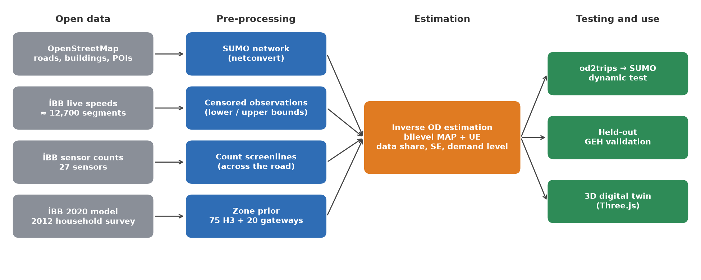

<span class="small">Every step is reproducible with a single command (`npm run sumo:net`, `sumo:map-ibb`, `od:corridor`). The inverse OD method is tested by 32 synthetic checks.</span>

---

<!-- _class: section -->

# 1 · Method

---

## Contribution 1: a speed is a censored observation

<div class="cols">
<div>

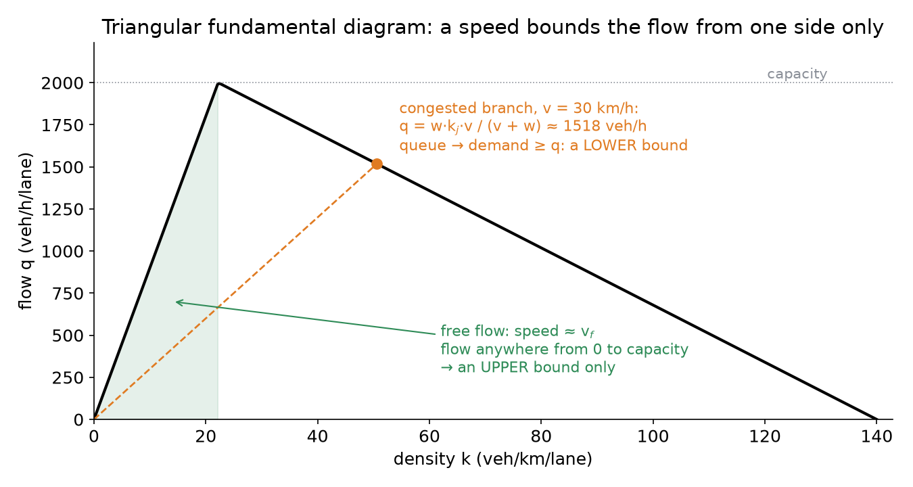

</div>
<div>

- **A free-flow speed does not determine the flow:** any flow between 0 and capacity is possible. The speed gives only an **upper bound**.
- **On the congested branch** q = w·k<sub>j</sub>·v / (v + w). A queue means demand exceeds the flow getting through, so the speed gives a **lower bound**.
- Whether a segment is congested is decided by İBB's own per-segment **congestion class**.

</div>
</div>

$$\min_{x \ge 0} \sum_{\text{counts}} \tfrac{((Px)_e - y_e)^2}{s_e^2} + \sum_{\text{lower}} \tfrac{\max(0,\, y_e - (Px)_e)^2}{s_e^2} + \sum_{\text{upper}} \tfrac{\max(0,\, (Px)_e - y_e)^2}{s_e^2} + \mathrm{KL}_\lambda(x \,\|\, x_0)$$

---

## Contribution 2: uncertainty and honest validation

- **Data share.** For each OD pair, the part of the estimate that comes from the data: 1 − σ²<sub>posterior</sub> / σ²<sub>prior</sub>. Laplace approximation; the Woodbury identity reduces an n × n inversion to an m × m solve.
- **Correlated prior errors.** x<sub>ij</sub> = x<sub>0,ij</sub> · e<sup>g + a<sub>i</sub> + b<sub>j</sub> + u<sub>ij</sub></sup>. Zone factors (a<sub>i</sub>, b<sub>j</sub>) correct a zone's whole traffic with a single number; **g** carries the level of the whole matrix.
- **Held-out validation.** GEH is measured not on the counts the model was fitted to, but on each count left out in turn.
- **Bilevel estimation.** UE assignment and estimation alternate; oscillation is damped by the method of successive averages (Spiess 1990; Yang et al. 1992).
- **Numerical conditioning.** Optimisation in log space (z = x<sub>0</sub>·e<sup>u</sup>); L-BFGS converges even when prior values span twelve orders of magnitude.

---

## Contribution 3: when is the level of demand anchored?

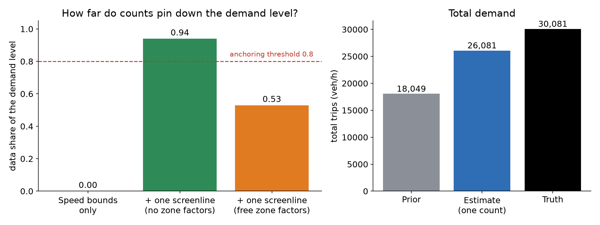

- The data share of the level comes from the curvature of the profile objective: σ²<sub>g</sub> = 2 / f″(g), share = 1 − σ²<sub>g</sub> / σ²<sub>prior</sub>.
- **Finding:** with free zone factors, a single screenline count determines only **half** of the level, because the count can also be met by inflating the zones it crosses. Anchoring the level takes **several counts crossing independent zones**.

---

## Synthetic benchmark: a city whose true OD is known

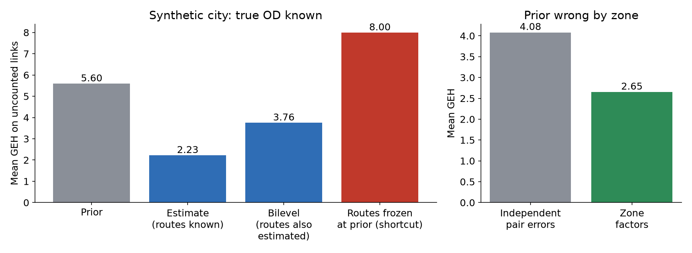

- Mean GEH on uncounted links falls from the prior's **5.6 to 2.2** (routes known) and **3.8** (routes also estimated). Freezing routes at the prior gives 8.0, so bilevel estimation is necessary.
- **96 % of true values lie within 2.5 standard errors:** the uncertainty is not over-confident.
- **Flows are identifiable; individual OD cells are not** (36 counts, 90 pairs). Reporting this openly is part of the contribution.

---

<!-- _class: section -->

# 2 · Real data

---

## Count pipeline and mapping audit

- 25 of İBB's 27 sensors were mapped to **screenlines** across the road on the SUMO network (both directions, all lanes).
- **Daily to hourly:** using the hourly share of probe vehicles in the same geohash cell on the same day; 3.6–5.1 % of the day for Saturday 17:00–18:00.

| Sensor | Daily | First mapping | Correction |
|---|---|---|---|
| Mecidiyeköy | 110 k | side street (no route) | O-1 |
| Çağlayan Junction | 103 k | single-lane street | O-1 |
| TEM Karanfilköy | 103 k | Uğur Mumcu Street | O-2 |
| FSM toll plaza | 81 k | same edges as the bridge entrance | removed (toll lanes only) |
| TEM before FSM toll | 98 k | both directions | one direction |

<div class="note">

On signalised arterials a low speed also comes from the red phase: lower bounds there inflated demand by 33 %. The rule is now restricted to **uninterrupted-flow** roads (motorway, trunk).

</div>

---

## GEH results: progress, but the criterion is not met

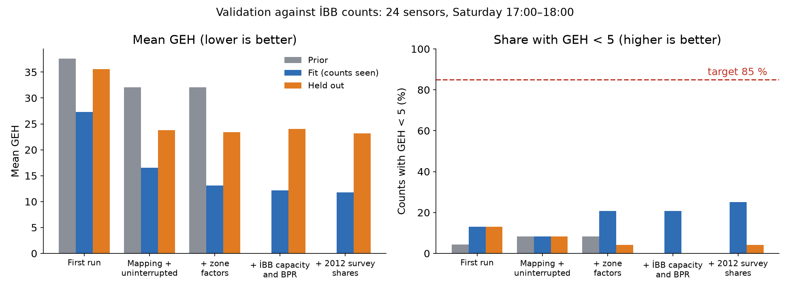

**Held-out mean GEH fell from 35.6 to 23.2, but the GEH < 5 criterion (85 %) is still far away.**

---

## Where does the remaining error come from?

<div class="cols">
<div>

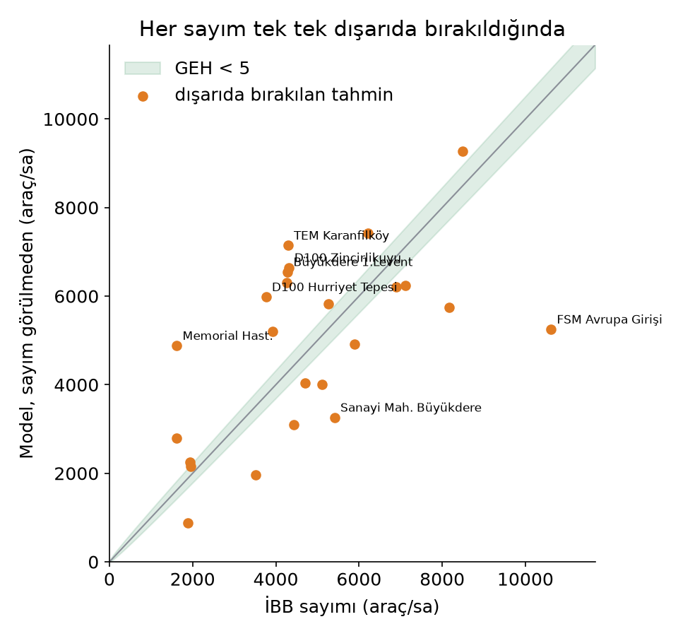
<span class="small">Each count left out in turn: İBB count (x) vs. model prediction without it (y); green band GEH < 5.</span>

</div>
<div>

1. **Count definitions conflict.** Three O-2 sensors settle on the same modelled flow, yet count 4,291 / 7,108 / 8,171 veh/h. Without ramps between them this is impossible: their direction or lane coverage must differ.
2. **Gateways and network.** At FSM the model can carry only half the count; the gateway prior is a crude capacity-based assumption.
3. **Prior.** Link parameters (İBB 2020 capacity and BPR) are not the bottleneck; trip-type shares from the 2012 survey bring a small improvement.

</div>
</div>

---

## Dynamic test: SUMO

<div class="cols">
<div>

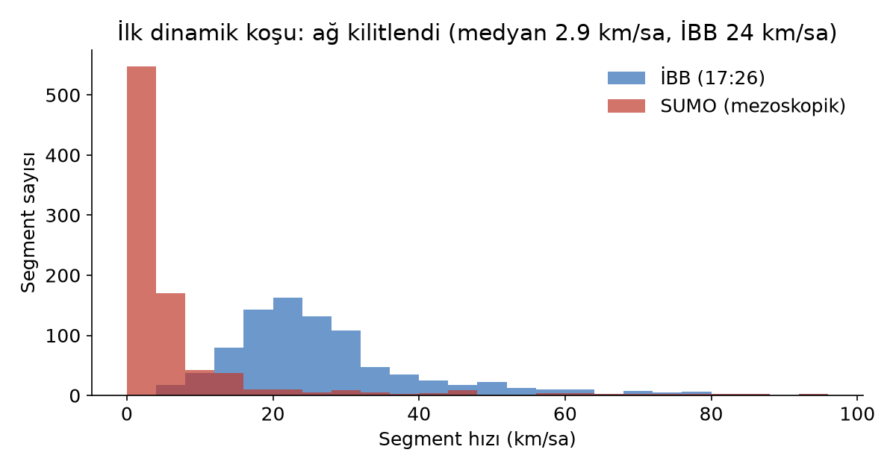
<span class="small">Segment speeds: İBB (blue) vs. SUMO mesoscopic run (red).</span>

</div>
<div>

- Estimate without counts: 128.6 k veh/h, 90 min, mesoscopic model, dynamic rerouting.
- **The network gridlocked:** 102,735 of 192,551 vehicles could enter; median speed 2.9 km/h (İBB: 24 km/h).
- This confirms that demand not anchored by counts was far too high: the bridge count is 8.5 k veh/h, the estimate loaded 13.9 k. The estimate with counts is 74 k veh/h.

</div>
</div>

<div class="note">

This result directly motivates measuring the level of demand separately (Contribution 3).

</div>

---

<!-- _class: section -->

# 3 · The 3D digital twin

---

## A procedural Istanbul from open data

<div class="cols">
<div>

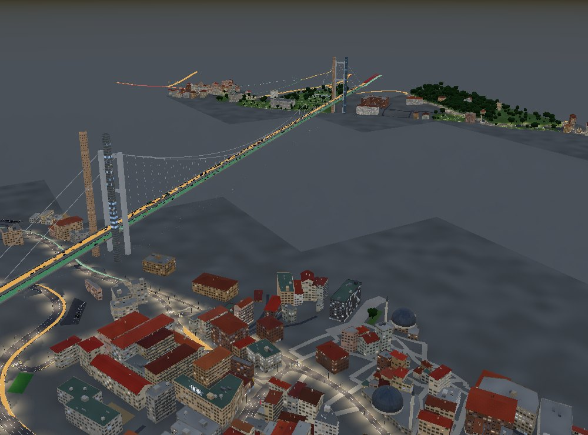
<span class="small">15 July Martyrs Bridge (towers, main cables, hangers) and the Ortaköy Mosque</span>

</div>
<div>

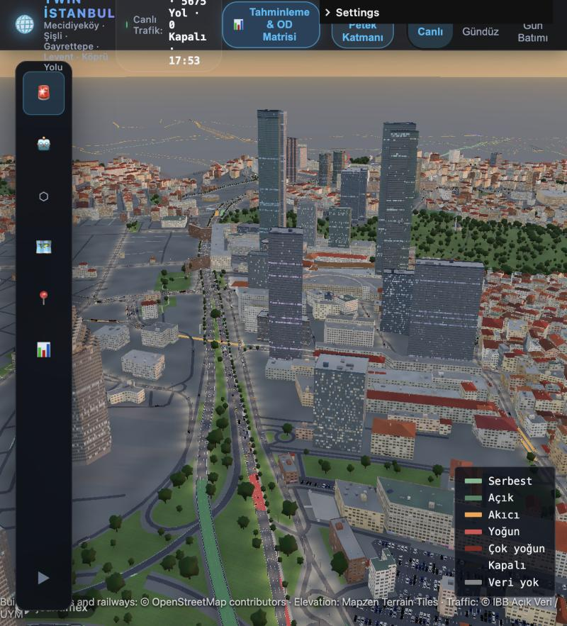
<span class="small">Levent: towers from OSM `building:part` data</span>

</div>
</div>

---

## Istanbul's urban fabric

<div class="cols3">
<div class="center">

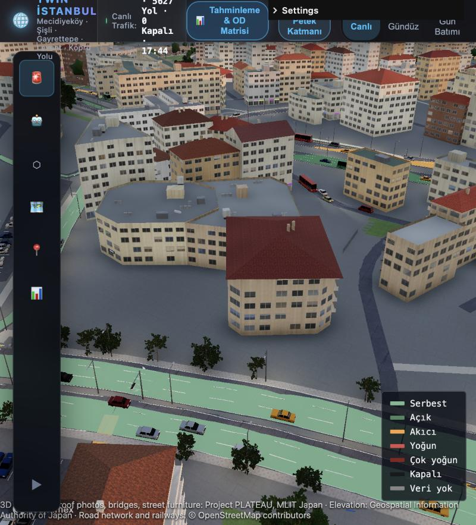
<span class="small">Hipped tile roofs, chimneys, rooftop water tanks</span>

</div>
<div class="center">

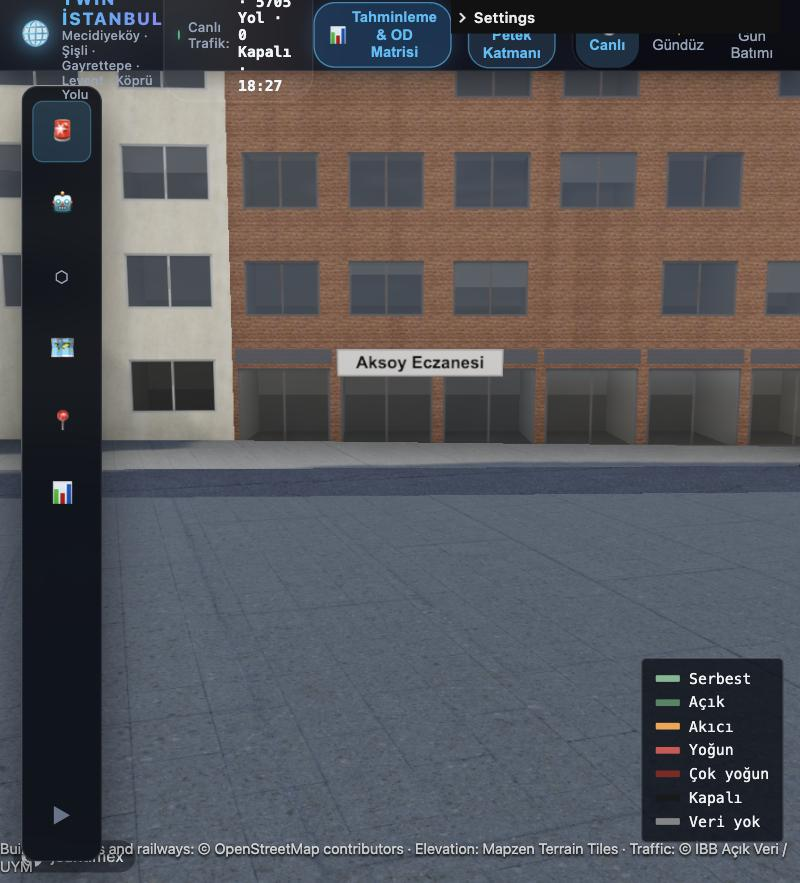
<span class="small">Shop fronts and signs with real shop names</span>

</div>
<div class="center">

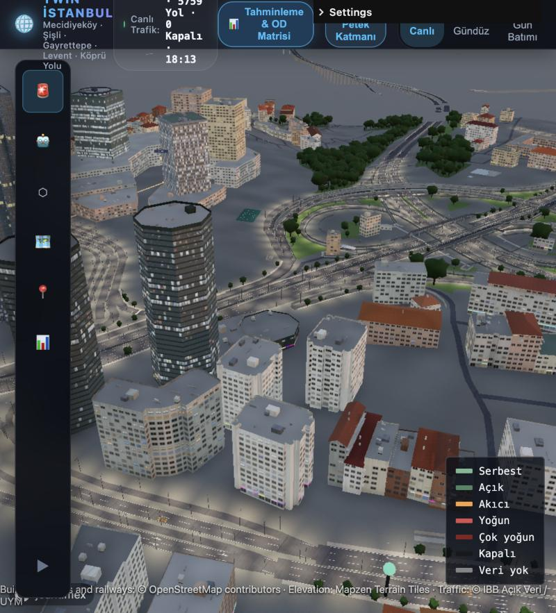
<span class="small">Zincirlikuyu: multi-level interchange and viaducts</span>

</div>
</div>

---

## Road geometry

<div class="cols">
<div>

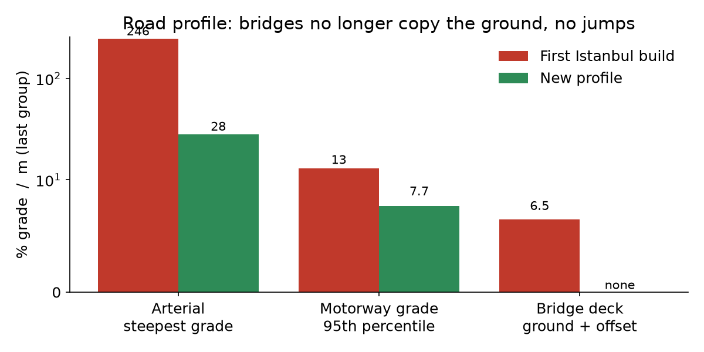

</div>
<div>

- **Bridges:** bridges over valleys or water get a flat deck from bank to bank.
- **Viaducts:** clearance above the ground below plus the layer; smoothed with vertical curves.
- **Tunnels** descend from the portal at 12 %; elevated roads are rounded with Chaikin's algorithm.
- **Performance:** 19.4 → 4.2 million triangles; 4,599 → 780 draw calls.

</div>
</div>

---

## Limitations

- **The validation criterion is not met:** held-out share with GEH < 5 is 4.2 % (target 85 %).
- **The demand level is only partly identified:** with free zone factors, a single bridge count anchors only half of it.
- **A single time slice:** one Saturday 17:00 snapshot; day-type and hourly variation are not yet modelled.
- **Static assignment:** no turn restrictions or queue spillback.
- **Hand-picked assumptions:** every prior parameter is listed in `summary.json`.
- **Literature:** the novelty of "speed as a censored observation" and "data share" must be confirmed by a systematic review.

---

## Next steps

1. **Sensor definitions:** confirm direction, lane coverage and toll/ramp distinctions with İBB (the conflicting O-2 sensors).
2. **Level of demand:** several independent counts (bridge directions separately, O-1 and O-2 screenlines); data share of the level ≥ 0.8.
3. **Time:** day-type and hourly profiles from the hourly density archive; continuous live speed archiving.
4. **Dynamic consistency:** test count-anchored demand in SUMO with scaled runs (25 / 50 / 75 / 100 %).
5. **Recommendation engine:** departure time, mode and bridge choice for drivers; bottleneck ranking and scenario comparison for the authority.

**Target publication path:** TRB Annual Meeting / hEART (method and case), then *Transportation Research Part C* (multi-week validation) and an open dataset paper.

---

## Reproducibility

```bash
npm run sumo:net -- --area=koridor          # OSM → SUMO network
npm run sumo:map-ibb -- --area=koridor      # İBB segments → edges
uv run --group sumo python tools/od/counts.py --area=koridor --month=2024-10 --weekday=5 --hour=17
uv run --group sumo python tools/od/corridor.py --area=koridor \
    --speeds data/od/koridor/20261017-1726/speeds.csv \
    --counts data/od/koridor/counts_202410_d5_h17.csv --tag counts
npm run test:od                             # synthetic validation (32 checks)
uv run --with matplotlib python tools/report/figures.py   # this deck's figures (TR and EN)
npm run dev                                 # 3D client: http://localhost:5280
```

Every assumption, intermediate result and negative finding is recorded with dates and numbers in the `tools/*/README.md` files.

---

## References

<div class="refs">

- Cascetta, E. (1984). Estimation of trip matrices from traffic counts and survey data: a generalized least squares estimator. *Transportation Research Part B*, 18(4–5).
- Chaikin, G. M. (1974). An algorithm for high-speed curve generation. *Computer Graphics and Image Processing*, 3(4).
- Daganzo, C. F. (1994). The cell transmission model. *Transportation Research Part B*, 28(4).
- Frederix, R., Viti, F., Corthout, R., Tampère, C. M. J. (2011). New gradient approximation method for dynamic origin–destination matrix estimation on congested networks. *Transportation Research Record*, 2263.
- Lopez, P. A. et al. (2018). Microscopic traffic simulation using SUMO. *IEEE ITSC*.
- Newell, G. F. (1993). A simplified theory of kinematic waves in highway traffic. *Transportation Research Part B*, 27(4).
- Spiess, H. (1990). A gradient approach for the O-D matrix adjustment problem. CRT, Université de Montréal.
- Van Zuylen, H. J., Willumsen, L. G. (1980). The most likely trip matrix estimated from traffic counts. *Transportation Research Part B*, 14(3).
- Yang, H., Sasaki, T., Iida, Y., Asakura, Y. (1992). Estimation of origin–destination matrices from link traffic counts on congested networks. *Transportation Research Part B*, 26(6).
- UK Department for Transport. TAG Unit M3.1, Highway Assignment Modelling (GEH criterion).
- İBB Open Data Portal (data.ibb.gov.tr): Daily Vehicle Counts, Hourly Traffic Density, Transport Demand Forecasting Model Data.

</div>

---

<!-- _class: title -->
<!-- _paginate: false -->

# Thank you

### Questions and feedback

<br>

github.com/aaasiroglu/procedural-istanbul
